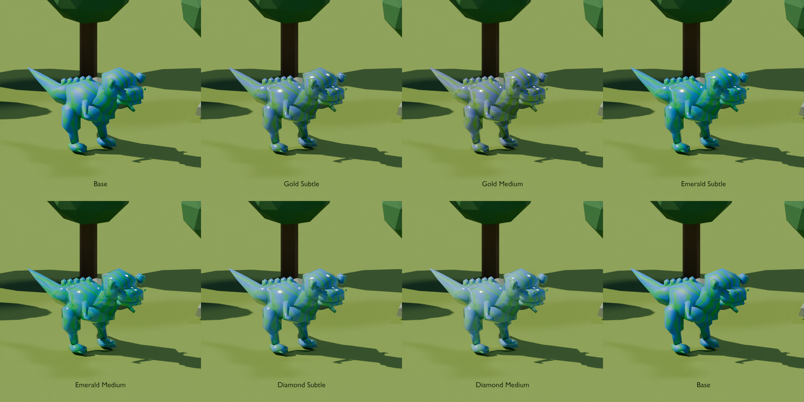
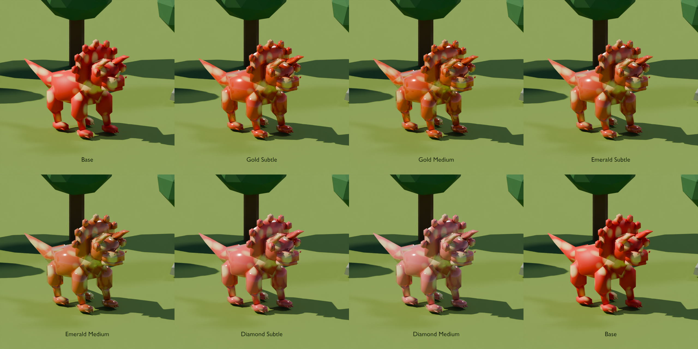
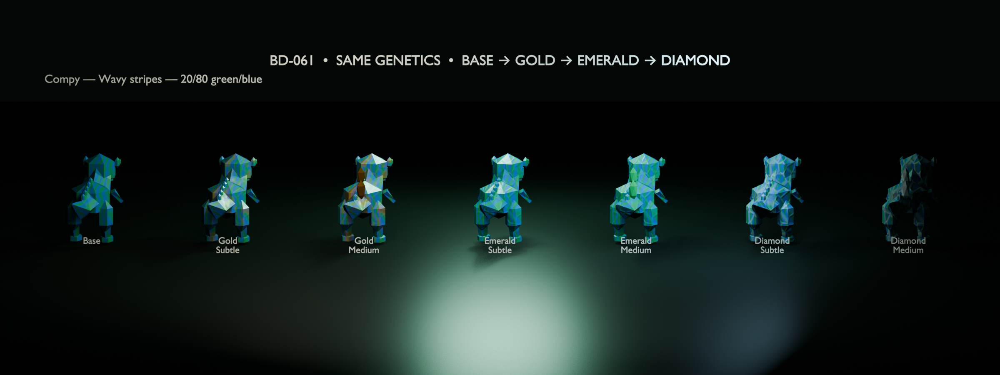
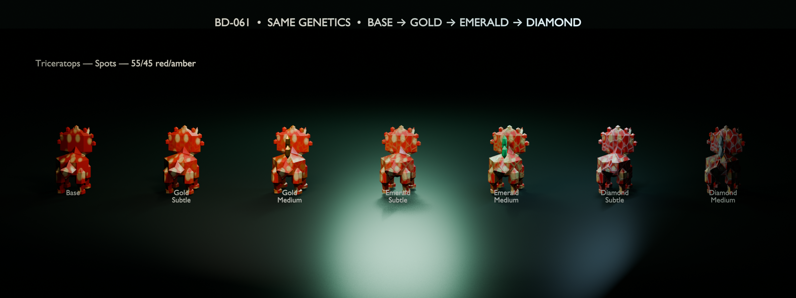
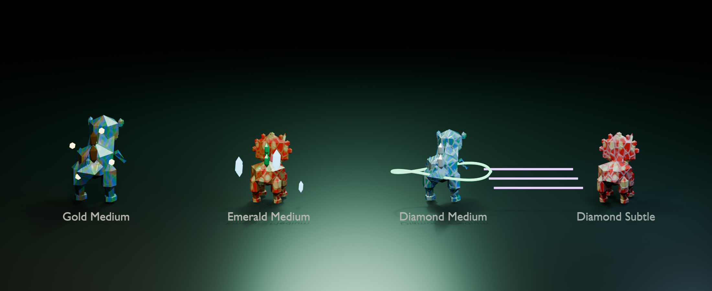

# BD-061 Gold, Emerald and Diamond fusion visual test

## Revision 2 — owner-directed glossy fusion finish

The current review candidate is `BD061_FusionFinish_Daylight_v2.blend` and its
appendable `BD061_FusionFinish_Library_v2.blend`. Working name: **Fusion finish**.
The owner's review supersedes the ornament/mineral-lattice direction below:
the finish is a continuous glossy coating, like a glazed toy, with a restrained
gold/emerald/cool-clear tint over the existing colors and markings. Subtle and
Medium change coat strength, roughness and tint; neither adds stones, crystals,
accessory meshes, facet bump, aura ornaments or particles.

Each tile uses exactly the same pose, camera, sunlight, sky, grass clearing and
background forest. The Base reference is repeated in the eighth tile. Individual
640-pixel panels are also included for closer inspection. These are Blender
Cycles renders of a game-style test clearing, not screenshots of the Roblox map.
The original low-poly silhouettes are retained; smooth shading lets the coating
catch continuous highlights. Both versions add **zero triangles, zero meshes,
and zero fusion particles**. The lower section records the rejected first study
and its historical stack fixtures; those do not establish v2 stack acceptance.

Rebuild with `tools/blender/build_fusion_finish.py`. The v2 material library
contains only the reusable shader group and materials. The daylight scene keeps
the fourteen species/treatment objects individually selectable in Blender.
Underlying stripe/spot patterns are procedural review fixtures, not calibrated
copies of the runtime UV masks; the old 20/80 and 55/45 fixture labels were not
measured color coverage and should not be used as verification of game genetics.

Roblox integration still needs the UV-bearing owner-uploaded models and actual
runtime gene ColorMap. Apply the finish through the existing mesh's material
roughness/metalness response, keep the generated genetic color map intact, and
resolve `PatternGenes` surface deletion before integrating. No new geometric
overlay or accessory attachment is required. BIG/Shiny/event/aura/trail remain
independent runtime systems; v2 Studio, phone and full stack tests are pending.

## Historical revision 1 — rejected visual study

**Date:** 2026-10-13

**Branch:** `codex/bd-061-fusion-visuals`

**Base:** `origin/main` at `ad5245c`

**Scope:** Visual assets, Blender experiments and this dedicated report only.
No gameplay, fusion RNG, persistence, collection schema, economy, Kanban, live
place or published Roblox asset was changed.

## Outcome

The prototype supplies six editable treatments from one shared Blender shader
group: Gold, Emerald and Diamond at Subtle and Medium intensities. Both tested
species retain their two genetic colors and pattern beneath the additive stage
mask. Medium adds one optional, consolidated 60-triangle crystal-detail mesh;
Subtle is shader-only.

Review plates use identical genetics inside each species row:

- Compy: Wavy stripes, 20/80 green/blue.
- Triceratops: Spots, 55/45 red/amber.

The stack plate keeps optional visual systems independent. It exercises Gold
Medium + BIG + Shiny, Emerald Medium + Frost, Diamond Medium + aura, and Diamond
Subtle + trail. These are forced art fixtures, not claims about fusion outcome
probabilities or inherited donor traits.

## Current pipeline inspection

- Build 020 has two creature paths. Legacy Compy/Triceratops are represented in
  this repository by lightweight OBJ sources. Newer creatures use authored
  single skinned meshes, 10–18 bones and shared-atlas/128×128 gene masks.
- `PatternGenes.luau` paints a per-dinosaur `EditableImage`, removes existing
  `SurfaceAppearance` children and writes the result as `TextureContent`.
- `GeneTextures.luau` can clone one neutral `SurfaceAppearance` template and
  tint it, but exits when a surface already exists.
- BIG is a coordinated 1.2× model scale. Shiny, event mutation, aura and trail
  are already independent client-side layers. Expensive Shiny/mutation effects
  are capped to eight nearby players and can be removed by reduced-effects mode.
- The checked-in Compy/Triceratops OBJ fallback files have no UV coordinates.
  Runtime documentation says the uploaded six-species meshes have usable UVs,
  but those editable UV-bearing source meshes are not present in Git.

## Treatment design

| Treatment | Subtle | Medium |
| --- | --- | --- |
| Gold | Warm selective metallic gloss, low facet relief, genetics dominant | Stronger gold trim, lower roughness, three joined low-poly accent crystals |
| Emerald | Polished green mineral highlights with restrained facet edges | Denser emerald facet network and joined crystal accents |
| Diamond | Cool reflective facet edges without transparent body replacement | Strongest coat/facet response and joined pale crystal accents |

The shared node group exposes Primary, Secondary, Accent, Pattern Kind,
Intensity, Metallic, Accent Roughness, Facet Strength and Coat Weight. It mixes
the genetic pattern first, then applies a sparse noise/facet mask. It does not
replace the full body with solid gold, green glass or white crystal.

## Roblox integration notes

The safest runtime shape is one `SurfaceAppearance` per creature mesh:

1. Keep the runtime-generated genetic image as `ColorMap`/`TextureContent`.
2. Supply stage/intensity-specific static Metalness, Roughness and Normal maps
   aligned to the creature UVs. The stage mask must not be baked into a fixed
   gene color map.
3. Merge the current gene painter and fusion surface ownership. The present
   `PatternGenes.apply` deletion of every `SurfaceAppearance` would otherwise
   remove a fusion surface; stacking arbitrary alpha PBR surfaces is not a safe
   assumption in Roblox.
4. Use the optional Medium accent as one rig-attached, non-colliding MeshPart or
   merge it into an export accessory. Do not create three independently
   simulated parts. Subtle needs no accessory mesh.
5. Apply BIG to the whole coordinated assembly. Keep Shiny, mutation, aura and
   trail in their existing client-side effect systems so each can be toggled,
   distance-capped and disabled by reduced-effects mode.
6. Preserve the new fused output's generated colors/pattern. No source texture
   or donor DNA is overwritten by these Blender treatments.

The procedural Generated-coordinate material in the `.blend` files is an
authoring source. Production Roblox maps should be UV-baked for the actual
owner-uploaded mesh revisions. A species-neutral mask can share node logic, but
the final baked mask/normal texture must match each distinct UV layout.

## Performance observations

| Item | Compy | Triceratops |
| --- | ---: | ---: |
| Source triangles | 712 | 988 |
| Source vertices | 424 | 594 |
| Subtle added geometry | 0 | 0 |
| Medium accent geometry | 60 triangles | 60 triangles |
| Medium planned extra mesh/draw layer | 1 | 1 |

The geometry increase is about 8.4% for Compy and 6.1% for Triceratops. This is
small in isolation, but it is not an FPS certification. Surface maps add texture
memory, the accessory adds a draw call, and Shiny/mutation/aura/trail cost must
be measured together with animation, the map and other players. A mobile path
should default to Subtle or omit the accessory at distance; existing reduced
effects should continue to disable animated particles without removing the
earned fusion surface.

## Missing assets and remaining verification

- UV-bearing editable Blender/FBX sources for the original six uploaded species,
  including Compy and Triceratops.
- Approved per-species UV masks and baked Color/Metalness/Roughness/Normal maps.
- Owner-bound Roblox asset IDs and non-owner published access checks.
- Studio validation of `EditableImage` + fusion `SurfaceAppearance` ownership,
  rig attachment, growth resizing, BIG, UI viewport crops and render ordering.
- Physical-phone frame time, texture memory, thermal/load tests and reduced-
  effects acceptance with multiple nearby fused dinosaurs.
- Broader body-type coverage across the remaining catalog after owner selection
  between Subtle and Medium. This task intentionally starts with two species.

No Studio verification is claimed. Blender 5.1 background generation and render
inspection are the only runtime evidence in this report.

## Reproduction and files

Run `tools/blender/build_fusion_visuals.py` with Blender 5.1. The script imports
the checked-in Compy and Triceratops OBJ files, rebuilds the reusable node group,
saves the three editable `.blend` files and regenerates the review plates.

See `assets/blender/fusion/README.md` and
`assets/blender/fusion/bd061-fusion-material-manifest.json` for the file and
measured-asset inventory.
