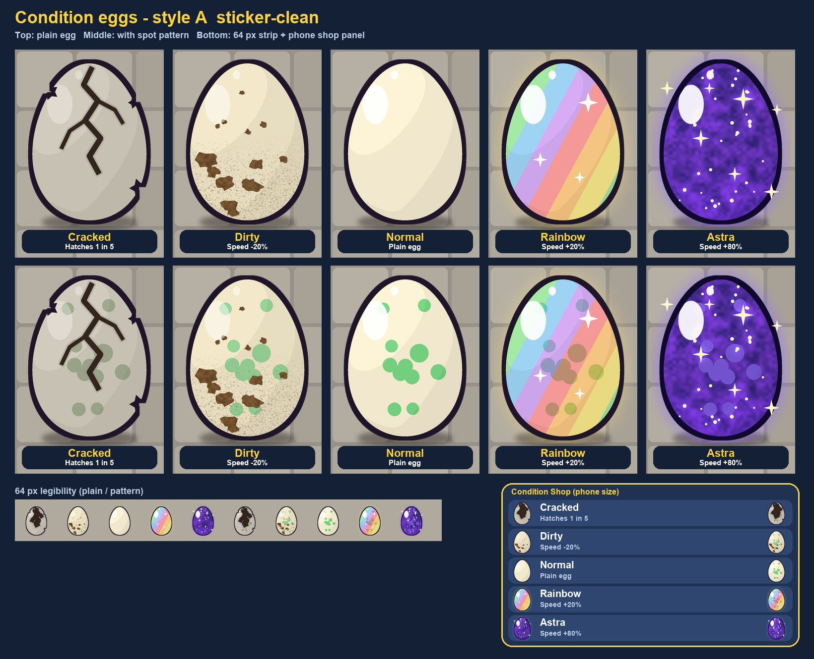
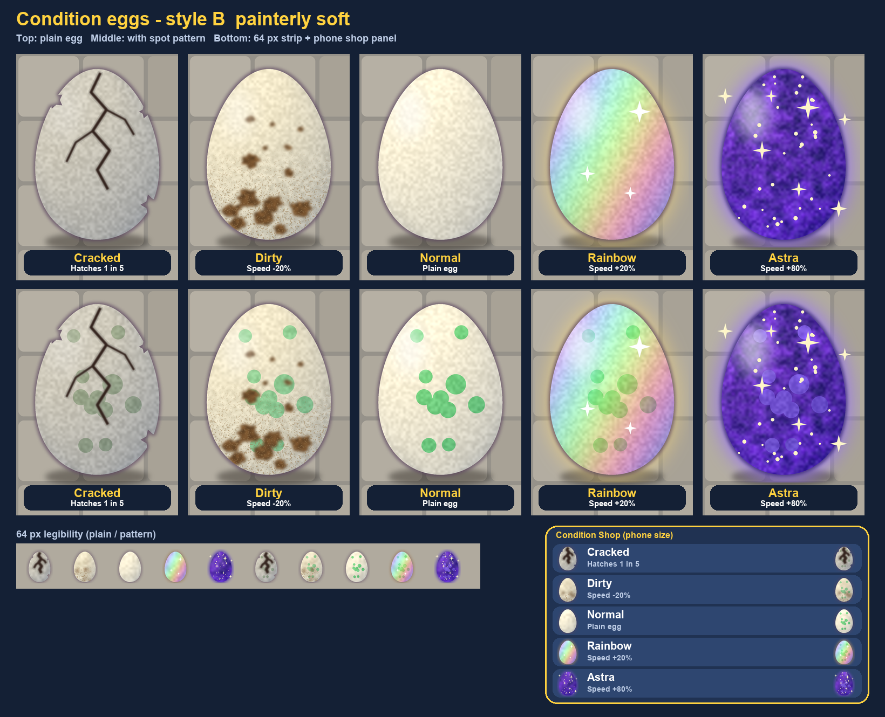

# 75 Condition egg concepts (BD-103, draft art only)

Problem: all five conditions render the same egg (`EggAppearance`/`EggGenetics.tint` never read `conditionId`). Players cannot see what Dirty or Astra is. Drafts only, per [docs/72](72-ui-copy-and-asset-standards.md); no gameplay code, no asset IDs. Generator: `tools/design/condition_egg_concepts.py`.

Boards (plain egg, spot-pattern egg, 64 px strip, phone shop panel): [A](evidence/2026-10-14-condition-eggs/board-A.png), [B](evidence/2026-10-14-condition-eggs/board-B.png), [side by side](evidence/2026-10-14-condition-eggs/comparison.png).

## Cues (same in both styles)
| Condition | Silhouette-level cue |
|---|---|
| Cracked | Dull grey shell, dark crack lines, chips missing from the outline |
| Dirty | Brown mud splotches low on the shell, dust specks |
| Normal | Clean cream, one gloss highlight (the baseline) |
| Rainbow | Prismatic sheen bands, white stars, warm glow |
| Astra | Deep indigo cosmic shell, stars, sparkle glow, floating sparkles outside the outline |

Shop card copy stays short (docs/72): "Hatches 1 in 5", "Speed -20%", "Plain egg", "Speed +20%", "Speed +80%".

## Styles
- **A sticker-clean** (matches the v2 kit and Candy Pop): chunky dark outline, 3-step cel shading, hard glossy highlight. Strongest at 64 px; every condition reads from its outline and colour blocks alone.
- **B painterly soft**: thin soft edge, brush noise, soft highlight. Prettier large, but Dirty and Cracked lose contrast at 64 px, and it matches the matte/illustrated direction of [docs/39](39-egg-appearance-shared-vision.md) better.

Pick: **A**. Reads at 64 px and phone size, fits the chunky kit, children read it fastest. Owner decision still needed (docs/39 asked for matte; A is glossy).

## Roblox implementation (existing layered renderer)
Keep the egg mesh and gene tint/pattern layers. Add a **condition layer** chosen by `genes.conditionId`:
| Layer | Texture (512 px, transparent PNG, UV of `Egg_Master`) | Notes |
|---|---|---|
| Cracked | `cond_cracked.png` cracks + dull overlay (grey 35% multiply) | Chips: baked into a second mesh `Egg_Master_Chipped` (3 notches), swap MeshId. |
| Dirty | `cond_dirty.png` mud + dust | Overlay Decal/SurfaceAppearance-less layer; pattern shows through the gaps. |
| Normal | none | Baseline gloss only. |
| Rainbow | `cond_rainbow_bands.png` (tiles, 512) + `cond_stars.png` (256) | Bands are a tinted overlay; a slow UV scroll is optional. |
| Astra | `cond_astra_shell.png` (512, replaces base colour, pattern drawn in lighter violet) + `cond_astra_stars.png` (256, additive) | `ParticleEmitter` (sparkle, rate 3-5, 0.4 s, reduced-effects off) + `PointLight`/Highlight glow. Cap emitters per distance budget. |
Shop and `EggPreview` use the same layer, so the card shows exactly what the egg will look like. Texture slots follow `Patterns.apply`; condition layers go on top, pattern below.

## Hatch reveal
- Cracked: egg shakes with creaks; 20% success pops, otherwise it crumbles into shell chips and dust (no new reward promised, consolation still open).
- Dirty: mud flakes off at the pop. Normal: standard pop.
- Rainbow: prism flash and confetti. Astra: star burst, short screen sparkle, louder sting (reuse sfx pack).

## Acceptance
- Five conditions visibly distinct on the world egg, nest egg, hatch preview and shop card, plain and patterned.
- Distinct at 64 px and phone landscape; checked in Studio next to the v2 kit.
- Pattern remains readable under every condition; no baked text or asset IDs invented.
- Reduced-effects mode drops Astra/Rainbow particles but keeps the textures.

## Tasks
See BD-104..BD-109 in [Kanban](07-kanban.md).
