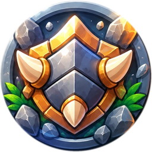
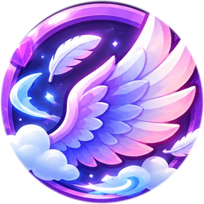
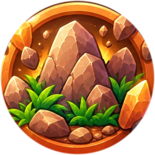
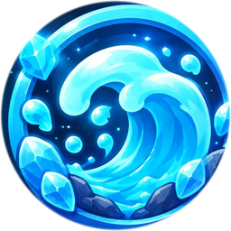
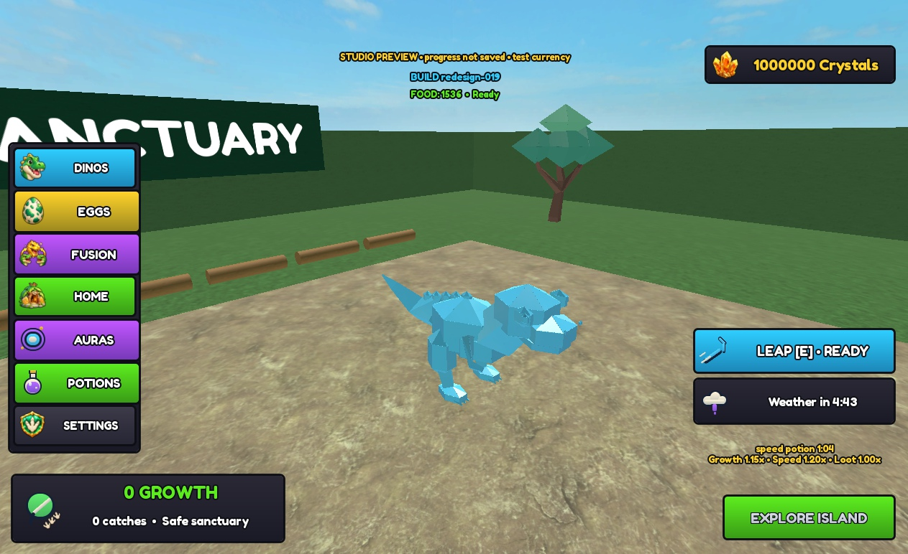
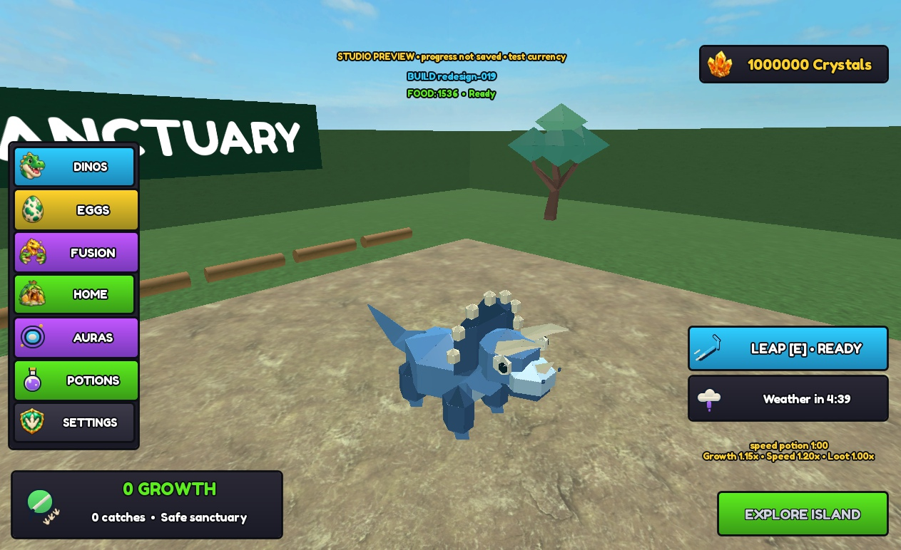
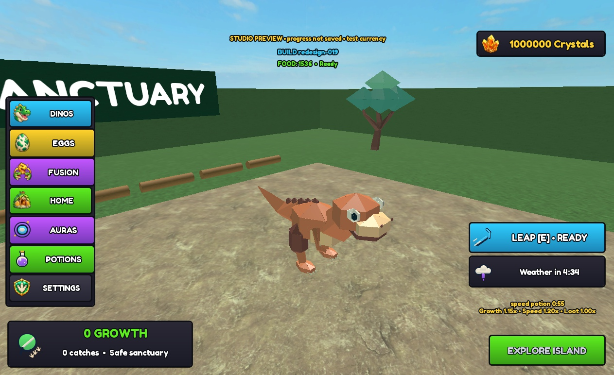
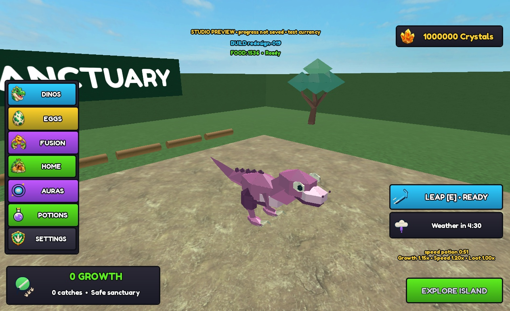
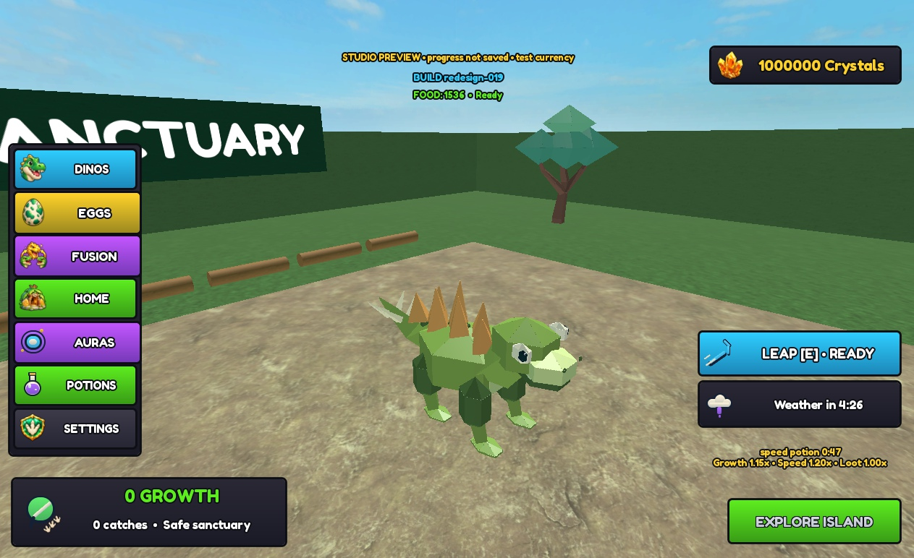
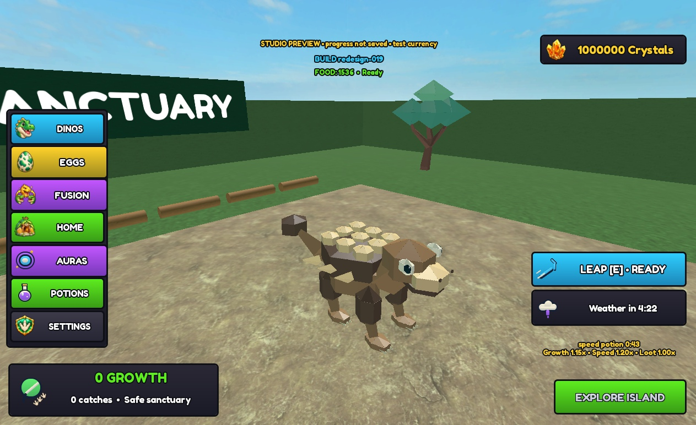

# Dinosaurs

Every dinosaur in the game with its picture, class, rarity and the chance to get it from an egg.

Generated by `tools/build_catalog.py` from the game code. Do not edit by hand: change the code, then run `python tools/build_catalog.py`.

## Contents

Pages: [Be Dino! team catalogue](Home.md) | **Dinosaurs** | [Eggs and looks](Eggs-and-looks.md) | [Mutations and fusion](Mutations-and-fusion.md) | [Shop items](Shop-items.md) | [World and food](World-and-food.md)

- [Rarity tiers](#rarity-tiers)
- [All dinosaurs](#all-dinosaurs)
- [Classes](#classes)
- [Status](#status)
- [The dinosaurs](#dinosaurs)
  [Compy](#dino-compy) | [Triceratops](#dino-triceratops) | [T-Rex](#dino-tyrannosaurus) | [Raptor](#dino-raptor) | [Stegosaurus](#dino-stegosaurus) | [Ankylosaurus](#dino-ankylosaurus) | [Archaeopteryx](#dino-archaeopteryx) | [Baryonyx](#dino-baryonyx) | [Brachiosaurus](#dino-brachiosaurus) | [Dimorphodon](#dino-dimorphodon) | [Elasmosaurus](#dino-elasmosaurus) | [Gallimimus](#dino-gallimimus) | [Ichthyosaurus](#dino-ichthyosaurus) | [Microraptor](#dino-microraptor) | [Mosasaurus](#dino-mosasaurus) | [Pachycephalosaurus](#dino-pachycephalosaurus) | [Parasaurolophus](#dino-parasaurolophus) | [Plesiosaurus](#dino-plesiosaurus) | [Pteranodon](#dino-pteranodon) | [Quetzalcoatlus](#dino-quetzalcoatlus) | [Spinosaurus](#dino-spinosaurus) | [Therizinosaurus](#dino-therizinosaurus)
- [Secret dinosaurs](#secret-dinosaurs)
  [Chickosaurus](#dino-chickosaurus) | [Pigeon](#dino-pigeon) | [Dodo](#dino-dodo) | [Duck](#dino-duck) | [Penguin](#dino-penguin) | [Budgiesaurus](#dino-budgiesaurus) | [Foxosaurus](#dino-foxosaurus) | [Cockatoosaurus](#dino-cockatoosaurus) | [Eaglesaurus](#dino-eaglesaurus)

## Rarity tiers

Chances are per egg. "Shop egg" is one egg bought with crystals. "Big run" is the best run-size boost (a batch of 120 eggs or more). All species odds are PROVISIONAL (see the Config comment).

| Rarity | Dinos | Shop egg | Big run | Which |
|---|---|---|---|---|
| Common | 5 | 91% | 90.55% | Compy, Raptor, Dimorphodon, Gallimimus, Microraptor |
| Uncommon | 5 | 8.5% | 8.458% | Stegosaurus, Archaeopteryx, Pachycephalosaurus, Parasaurolophus, Pteranodon |
| Rare | 5 | 0.42% | 0.8358% | Triceratops, Baryonyx, Brachiosaurus, Ichthyosaurus, Plesiosaurus |
| Epic | 4 | 0.07% | 0.1393% | Ankylosaurus, Elasmosaurus, Quetzalcoatlus, Therizinosaurus |
| Legendary | 3 | 0.01% | 0.0199% | T-Rex, Mosasaurus, Spinosaurus |

## All dinosaurs

22 dinosaurs.

| Dino | Class | Rarity | Shop egg (PROVISIONAL) | Big run | Size |
|---|---|---|---|---|---|
| [Compy](#dino-compy) | Ground | Common (tier 1 of 5) | 36.4% | 36.22% | 6.6 studs tall |
| [Triceratops](#dino-triceratops) | Ground | Rare (tier 3 of 5) | 0.13% | 0.2587% | 8 studs tall |
| [T-Rex](#dino-tyrannosaurus) | Ground | Legendary (tier 5 of 5) | 0.004% | 0.00796% | 10.6 studs tall |
| [Raptor](#dino-raptor) | Ground | Common (tier 1 of 5) | 26% | 25.87% | 6.6 studs tall |
| [Stegosaurus](#dino-stegosaurus) | Ground | Uncommon (tier 2 of 5) | 2.2% | 2.189% | 7.25 studs tall |
| [Ankylosaurus](#dino-ankylosaurus) | Armored | Epic (tier 4 of 5) | 0.02% | 0.0398% | 6.51 studs tall |
| [Archaeopteryx](#dino-archaeopteryx) | Fly | Uncommon (tier 2 of 5) | 2.2% | 2.189% | 5.31 studs tall |
| [Baryonyx](#dino-baryonyx) | Ground | Rare (tier 3 of 5) | 0.07% | 0.1393% | 7.99 studs tall |
| [Brachiosaurus](#dino-brachiosaurus) | Ground | Rare (tier 3 of 5) | 0.09% | 0.1791% | 8 studs tall |
| [Dimorphodon](#dino-dimorphodon) | Fly | Common (tier 1 of 5) | 7% | 6.965% | 5.13 studs tall |
| [Elasmosaurus](#dino-elasmosaurus) | Ground | Epic (tier 4 of 5) | 0.02% | 0.0398% | 8.78 studs tall |
| [Gallimimus](#dino-gallimimus) | Ground | Common (tier 1 of 5) | 12% | 11.94% | 6.61 studs tall |
| [Ichthyosaurus](#dino-ichthyosaurus) | Water | Rare (tier 3 of 5) | 0.065% | 0.1294% | 5.57 studs tall |
| [Microraptor](#dino-microraptor) | Fly | Common (tier 1 of 5) | 9.6% | 9.552% | 4.56 studs tall |
| [Mosasaurus](#dino-mosasaurus) | Water | Legendary (tier 5 of 5) | 0.003% | 0.00597% | 5.77 studs tall |
| [Pachycephalosaurus](#dino-pachycephalosaurus) | Ground | Uncommon (tier 2 of 5) | 1.3% | 1.294% | 7.25 studs tall |
| [Parasaurolophus](#dino-parasaurolophus) | Ground | Uncommon (tier 2 of 5) | 1.7% | 1.692% | 7.27 studs tall |
| [Plesiosaurus](#dino-plesiosaurus) | Water | Rare (tier 3 of 5) | 0.065% | 0.1294% | 7.74 studs tall |
| [Pteranodon](#dino-pteranodon) | Fly | Uncommon (tier 2 of 5) | 1.1% | 1.095% | 4.62 studs tall |
| [Quetzalcoatlus](#dino-quetzalcoatlus) | Fly | Epic (tier 4 of 5) | 0.015% | 0.02985% | 6.12 studs tall |
| [Spinosaurus](#dino-spinosaurus) | Ground | Legendary (tier 5 of 5) | 0.003% | 0.00597% | 9.66 studs tall |
| [Therizinosaurus](#dino-therizinosaurus) | Ground | Epic (tier 4 of 5) | 0.015% | 0.02985% | 8.78 studs tall |

**SECRET, internal only.** 9 secret dinosaurs. The chance is per run or nest egg, never a shop egg.

| Dino | Class | Rarity | Run or nest egg | Same in a big run | Size |
|---|---|---|---|---|---|
| [Chickosaurus](#dino-chickosaurus) | Ground | SECRET, internal only | 0.09259% | 0.09259% | 6.61 studs tall |
| [Pigeon](#dino-pigeon) | Ground | SECRET, internal only | 0.09259% | 0.09259% | 6.61 studs tall |
| [Dodo](#dino-dodo) | Ground | SECRET, internal only | 0.06481% | 0.06481% | 6.61 studs tall |
| [Duck](#dino-duck) | Ground | SECRET, internal only | 0.08333% | 0.08333% | 6.61 studs tall |
| [Penguin](#dino-penguin) | Water | SECRET, internal only | 0.05556% | 0.05556% | 6.19 studs tall |
| [Budgiesaurus](#dino-budgiesaurus) | Fly | SECRET, internal only | 0.0463% | 0.0463% | 6.6 studs tall |
| [Foxosaurus](#dino-foxosaurus) | Ground | SECRET, internal only | 0.02778% | 0.02778% | 6.64 studs tall |
| [Cockatoosaurus](#dino-cockatoosaurus) | Fly | SECRET, internal only | 0.02315% | 0.02315% | 6.66 studs tall |
| [Eaglesaurus](#dino-eaglesaurus) | Fly | SECRET, internal only | 0.01389% | 0.01389% | 5.52 studs tall |

## Classes

| Class | What it does | Dinos | Icon | Icon id |
|---|---|---|---|---|
| Armored | Tough armor | 1 |  | bound |
| Fly | Flies and glides | 8 |  | bound |
| Ground | Fast runner | 18 |  | bound |
| Water | Swims and dashes | 4 |  | bound |

## Status

**STATUS** Picture = a dino picture file in the repository. Model = the generated 3D model id is written into the code. Pictures go to `resources/ui/v2/dinos/<id>-v1.png` (square).

| Dino | Picture | Model id | Mask | Odds from |
|---|---|---|---|---|
| [Compy](#dino-compy) | yes: `docs/evidence/2026-10-08-icons-and-acceptance/desktop-species-compy.png` | model bound | n/a (procedural patterns) | `src/shared/Config.luau` ChestSpeciesWeights |
| [Triceratops](#dino-triceratops) | yes: `docs/evidence/2026-10-08-icons-and-acceptance/desktop-species-triceratops.png` | model bound | n/a (procedural patterns) | `src/shared/Config.luau` ChestSpeciesWeights |
| [T-Rex](#dino-tyrannosaurus) | yes: `docs/evidence/2026-10-08-icons-and-acceptance/desktop-species-tyrannosaurus.png` | model bound | n/a (procedural patterns) | `src/shared/Config.luau` ChestSpeciesWeights |
| [Raptor](#dino-raptor) | yes: `docs/evidence/2026-10-08-icons-and-acceptance/desktop-species-raptor.png` | model bound | n/a (procedural patterns) | `src/shared/Config.luau` ChestSpeciesWeights |
| [Stegosaurus](#dino-stegosaurus) | yes: `docs/evidence/2026-10-08-icons-and-acceptance/desktop-species-stegosaurus.png` | model bound | n/a (procedural patterns) | `src/shared/Config.luau` ChestSpeciesWeights |
| [Ankylosaurus](#dino-ankylosaurus) | yes: `docs/evidence/2026-10-08-icons-and-acceptance/desktop-species-ankylosaurus.png` | model bound | n/a (procedural patterns) | `src/shared/Config.luau` ChestSpeciesWeights |
| [Archaeopteryx](#dino-archaeopteryx) | MISSING | model bound | n/a (procedural patterns) | `src/shared/Config.luau` ChestSpeciesWeights |
| [Baryonyx](#dino-baryonyx) | MISSING | model bound | n/a (procedural patterns) | `src/shared/Config.luau` ChestSpeciesWeights |
| [Brachiosaurus](#dino-brachiosaurus) | MISSING | model bound | n/a (procedural patterns) | `src/shared/Config.luau` ChestSpeciesWeights |
| [Dimorphodon](#dino-dimorphodon) | MISSING | model bound | n/a (procedural patterns) | `src/shared/Config.luau` ChestSpeciesWeights |
| [Elasmosaurus](#dino-elasmosaurus) | MISSING | model bound | n/a (procedural patterns) | `src/shared/Config.luau` ChestSpeciesWeights |
| [Gallimimus](#dino-gallimimus) | MISSING | model bound | n/a (procedural patterns) | `src/shared/Config.luau` ChestSpeciesWeights |
| [Ichthyosaurus](#dino-ichthyosaurus) | MISSING | model bound | n/a (procedural patterns) | `src/shared/Config.luau` ChestSpeciesWeights |
| [Microraptor](#dino-microraptor) | MISSING | model bound | n/a (procedural patterns) | `src/shared/Config.luau` ChestSpeciesWeights |
| [Mosasaurus](#dino-mosasaurus) | MISSING | model bound | n/a (procedural patterns) | `src/shared/Config.luau` ChestSpeciesWeights |
| [Pachycephalosaurus](#dino-pachycephalosaurus) | MISSING | model bound | n/a (procedural patterns) | `src/shared/Config.luau` ChestSpeciesWeights |
| [Parasaurolophus](#dino-parasaurolophus) | MISSING | model bound | n/a (procedural patterns) | `src/shared/Config.luau` ChestSpeciesWeights |
| [Plesiosaurus](#dino-plesiosaurus) | MISSING | model bound | n/a (procedural patterns) | `src/shared/Config.luau` ChestSpeciesWeights |
| [Pteranodon](#dino-pteranodon) | MISSING | model bound | n/a (procedural patterns) | `src/shared/Config.luau` ChestSpeciesWeights |
| [Quetzalcoatlus](#dino-quetzalcoatlus) | MISSING | model bound | n/a (procedural patterns) | `src/shared/Config.luau` ChestSpeciesWeights |
| [Spinosaurus](#dino-spinosaurus) | MISSING | model bound | n/a (procedural patterns) | `src/shared/Config.luau` ChestSpeciesWeights |
| [Therizinosaurus](#dino-therizinosaurus) | MISSING | model bound | n/a (procedural patterns) | `src/shared/Config.luau` ChestSpeciesWeights |
| [Chickosaurus](#dino-chickosaurus) | MISSING | model bound | n/a (procedural patterns) | `src/shared/SecretSpeciesConfig.luau` |
| [Pigeon](#dino-pigeon) | MISSING | model bound | n/a (procedural patterns) | `src/shared/SecretSpeciesConfig.luau` |
| [Dodo](#dino-dodo) | MISSING | model bound | n/a (procedural patterns) | `src/shared/SecretSpeciesConfig.luau` |
| [Duck](#dino-duck) | MISSING | model bound | n/a (procedural patterns) | `src/shared/SecretSpeciesConfig.luau` |
| [Penguin](#dino-penguin) | MISSING | model bound | n/a (procedural patterns) | `src/shared/SecretSpeciesConfig.luau` |
| [Budgiesaurus](#dino-budgiesaurus) | MISSING | model bound | n/a (procedural patterns) | `src/shared/SecretSpeciesConfig.luau` |
| [Foxosaurus](#dino-foxosaurus) | MISSING | model bound | n/a (procedural patterns) | `src/shared/SecretSpeciesConfig.luau` |
| [Cockatoosaurus](#dino-cockatoosaurus) | MISSING | model bound | n/a (procedural patterns) | `src/shared/SecretSpeciesConfig.luau` |
| [Eaglesaurus](#dino-eaglesaurus) | MISSING | model bound | n/a (procedural patterns) | `src/shared/SecretSpeciesConfig.luau` |

## The dinosaurs

### Compy

id: `compy`

- **Class:** Ground (Fast runner)
- **Rarity:** Common (tier 1 of 5)
- **Chance per egg:** 36.4% from a shop egg (1 in 2.75); 36.22% in a big run (PROVISIONAL)
- **Size:** 6.6 studs tall, 7.69 long, 3.49 wide

### Triceratops

id: `triceratops`

- **Class:** Ground (Fast runner)
- **Rarity:** Rare (tier 3 of 5)
- **Chance per egg:** 0.13% from a shop egg (1 in 769); 0.2587% in a big run (PROVISIONAL)
- **Size:** 8 studs tall, 8.58 long, 5.79 wide

### T-Rex

id: `tyrannosaurus`

- **Class:** Ground (Fast runner)
- **Rarity:** Legendary (tier 5 of 5)
- **Chance per egg:** 0.004% from a shop egg (1 in 25,000); 0.00796% in a big run (PROVISIONAL)
- **Size:** 10.6 studs tall, 11.4 long, 5.83 wide (estimated, not measured in Studio)

### Raptor

id: `raptor`

- **Class:** Ground (Fast runner)
- **Rarity:** Common (tier 1 of 5)
- **Chance per egg:** 26% from a shop egg (1 in 3.85); 25.87% in a big run (PROVISIONAL)
- **Size:** 6.6 studs tall, 7.74 long, 3.49 wide

### Stegosaurus

id: `stegosaurus`

- **Class:** Ground (Fast runner)
- **Rarity:** Uncommon (tier 2 of 5)
- **Chance per egg:** 2.2% from a shop egg (1 in 45); 2.189% in a big run (PROVISIONAL)
- **Size:** 7.25 studs tall, 11.7 long, 5.25 wide

### Ankylosaurus

id: `ankylosaurus`

- **Class:** Armored (Tough armor)
- **Rarity:** Epic (tier 4 of 5)
- **Chance per egg:** 0.02% from a shop egg (1 in 5,000); 0.0398% in a big run (PROVISIONAL)
- **Size:** 6.51 studs tall, 10.7 long, 5.77 wide (estimated, not measured in Studio)

### Archaeopteryx

id: `archaeopteryx`

_No picture yet (see Missing on the Home page)._

- **Class:** Fly (Flies and glides)
- **Rarity:** Uncommon (tier 2 of 5)
- **Chance per egg:** 2.2% from a shop egg (1 in 45); 2.189% in a big run (PROVISIONAL)
- **Size:** 5.31 studs tall, 5.92 long, 7.17 wide

### Baryonyx

id: `baryonyx`

_No picture yet (see Missing on the Home page)._

- **Class:** Ground (Fast runner)
- **Rarity:** Rare (tier 3 of 5)
- **Chance per egg:** 0.07% from a shop egg (1 in 1,429); 0.1393% in a big run (PROVISIONAL)
- **Size:** 7.99 studs tall, 9.33 long, 3.99 wide

### Brachiosaurus

id: `brachiosaurus`

_No picture yet (see Missing on the Home page)._

- **Class:** Ground (Fast runner)
- **Rarity:** Rare (tier 3 of 5)
- **Chance per egg:** 0.09% from a shop egg (1 in 1,111); 0.1791% in a big run (PROVISIONAL)
- **Size:** 8 studs tall, 8.73 long, 3.73 wide

### Dimorphodon

id: `dimorphodon`

_No picture yet (see Missing on the Home page)._

- **Class:** Fly (Flies and glides)
- **Rarity:** Common (tier 1 of 5)
- **Chance per egg:** 7% from a shop egg (1 in 14); 6.965% in a big run (PROVISIONAL)
- **Size:** 5.13 studs tall, 5.73 long, 5.76 wide

### Elasmosaurus

id: `elasmosaurus`

_No picture yet (see Missing on the Home page)._

- **Class:** Ground (Fast runner)
- **Rarity:** Epic (tier 4 of 5)
- **Chance per egg:** 0.02% from a shop egg (1 in 5,000); 0.0398% in a big run (PROVISIONAL)
- **Size:** 8.78 studs tall, 10.7 long, 3.95 wide

### Gallimimus

id: `gallimimus`

_No picture yet (see Missing on the Home page)._

- **Class:** Ground (Fast runner)
- **Rarity:** Common (tier 1 of 5)
- **Chance per egg:** 12% from a shop egg (1 in 8.33); 11.94% in a big run (PROVISIONAL)
- **Size:** 6.61 studs tall, 7.78 long, 2.42 wide

### Ichthyosaurus

id: `ichthyosaurus`

_No picture yet (see Missing on the Home page)._

- **Class:** Water (Swims and dashes)
- **Rarity:** Rare (tier 3 of 5)
- **Chance per egg:** 0.065% from a shop egg (1 in 1,538); 0.1294% in a big run (PROVISIONAL)
- **Size:** 5.57 studs tall, 11.1 long, 4.89 wide

### Microraptor

id: `microraptor`

_No picture yet (see Missing on the Home page)._

- **Class:** Fly (Flies and glides)
- **Rarity:** Common (tier 1 of 5)
- **Chance per egg:** 9.6% from a shop egg (1 in 10); 9.552% in a big run (PROVISIONAL)
- **Size:** 4.56 studs tall, 5.29 long, 7.11 wide

### Mosasaurus

id: `mosasaurus`

_No picture yet (see Missing on the Home page)._

- **Class:** Water (Swims and dashes)
- **Rarity:** Legendary (tier 5 of 5)
- **Chance per egg:** 0.003% from a shop egg (1 in 33,333); 0.00597% in a big run (PROVISIONAL)
- **Size:** 5.77 studs tall, 16.9 long, 5.48 wide

### Pachycephalosaurus

id: `pachycephalosaurus`

_No picture yet (see Missing on the Home page)._

- **Class:** Ground (Fast runner)
- **Rarity:** Uncommon (tier 2 of 5)
- **Chance per egg:** 1.3% from a shop egg (1 in 77); 1.294% in a big run (PROVISIONAL)
- **Size:** 7.25 studs tall, 8.43 long, 4.51 wide

### Parasaurolophus

id: `parasaurolophus`

_No picture yet (see Missing on the Home page)._

- **Class:** Ground (Fast runner)
- **Rarity:** Uncommon (tier 2 of 5)
- **Chance per egg:** 1.7% from a shop egg (1 in 59); 1.692% in a big run (PROVISIONAL)
- **Size:** 7.27 studs tall, 9.09 long, 5.3 wide

### Plesiosaurus

id: `plesiosaurus`

_No picture yet (see Missing on the Home page)._

- **Class:** Water (Swims and dashes)
- **Rarity:** Rare (tier 3 of 5)
- **Chance per egg:** 0.065% from a shop egg (1 in 1,538); 0.1294% in a big run (PROVISIONAL)
- **Size:** 7.74 studs tall, 8.34 long, 4.66 wide

### Pteranodon

id: `pteranodon`

_No picture yet (see Missing on the Home page)._

- **Class:** Fly (Flies and glides)
- **Rarity:** Uncommon (tier 2 of 5)
- **Chance per egg:** 1.1% from a shop egg (1 in 91); 1.095% in a big run (PROVISIONAL)
- **Size:** 4.62 studs tall, 6.89 long, 7.07 wide

### Quetzalcoatlus

id: `quetzalcoatlus`

_No picture yet (see Missing on the Home page)._

- **Class:** Fly (Flies and glides)
- **Rarity:** Epic (tier 4 of 5)
- **Chance per egg:** 0.015% from a shop egg (1 in 6,667); 0.02985% in a big run (PROVISIONAL)
- **Size:** 6.12 studs tall, 8.04 long, 8.2 wide

### Spinosaurus

id: `spinosaurus`

_No picture yet (see Missing on the Home page)._

- **Class:** Ground (Fast runner)
- **Rarity:** Legendary (tier 5 of 5)
- **Chance per egg:** 0.003% from a shop egg (1 in 33,333); 0.00597% in a big run (PROVISIONAL)
- **Size:** 9.66 studs tall, 12.1 long, 5.53 wide

### Therizinosaurus

id: `therizinosaurus`

_No picture yet (see Missing on the Home page)._

- **Class:** Ground (Fast runner)
- **Rarity:** Epic (tier 4 of 5)
- **Chance per egg:** 0.015% from a shop egg (1 in 6,667); 0.02985% in a big run (PROVISIONAL)
- **Size:** 8.78 studs tall, 10.2 long, 4.91 wide

## Secret dinosaurs

**SECRET, internal only.** Secret species are not in the 22-species Index count. A flat chance per run or nest egg, then a pick by weight. Switch: off in the default build, on in the playtest build.

### Chickosaurus

id: `chickosaurus`

_No picture yet (see Missing on the Home page)._

- **Class:** Ground (Fast runner)
- **Rarity:** SECRET, internal only
- **Chance:** 0.09259% of a run or nest egg (1 in 1,080); never from a shop egg
- **Size:** 6.61 studs tall, 6.12 long, 3.92 wide
- **Notes:** SECRET, internal only. Switch: off in the default build, on in the playtest build.

### Pigeon

id: `pigeon`

_No picture yet (see Missing on the Home page)._

- **Class:** Ground (Fast runner)
- **Rarity:** SECRET, internal only
- **Chance:** 0.09259% of a run or nest egg (1 in 1,080); never from a shop egg
- **Size:** 6.61 studs tall, 5.72 long, 5.21 wide
- **Notes:** SECRET, internal only. Switch: off in the default build, on in the playtest build.

### Dodo

id: `dodo`

_No picture yet (see Missing on the Home page)._

- **Class:** Ground (Fast runner)
- **Rarity:** SECRET, internal only
- **Chance:** 0.06481% of a run or nest egg (1 in 1,543); never from a shop egg
- **Size:** 6.61 studs tall, 6.92 long, 3.81 wide
- **Notes:** SECRET, internal only. Switch: off in the default build, on in the playtest build.

### Duck

id: `duck`

_No picture yet (see Missing on the Home page)._

- **Class:** Ground (Fast runner)
- **Rarity:** SECRET, internal only
- **Chance:** 0.08333% of a run or nest egg (1 in 1,200); never from a shop egg
- **Size:** 6.61 studs tall, 6.06 long, 4.39 wide
- **Notes:** SECRET, internal only. Switch: off in the default build, on in the playtest build.

### Penguin

id: `penguin`

_No picture yet (see Missing on the Home page)._

- **Class:** Water (Swims and dashes)
- **Rarity:** SECRET, internal only
- **Chance:** 0.05556% of a run or nest egg (1 in 1,800); never from a shop egg
- **Size:** 6.19 studs tall, 4.76 long, 5.81 wide
- **Notes:** SECRET, internal only. Switch: off in the default build, on in the playtest build.

### Budgiesaurus

id: `budgiesaurus`

_No picture yet (see Missing on the Home page)._

- **Class:** Fly (Flies and glides)
- **Rarity:** SECRET, internal only
- **Chance:** 0.0463% of a run or nest egg (1 in 2,160); never from a shop egg
- **Size:** 6.6 studs tall, 7.12 long, 3.6 wide
- **Notes:** SECRET, internal only. Switch: off in the default build, on in the playtest build.

### Foxosaurus

id: `foxosaurus`

_No picture yet (see Missing on the Home page)._

- **Class:** Ground (Fast runner)
- **Rarity:** SECRET, internal only
- **Chance:** 0.02778% of a run or nest egg (1 in 3,600); never from a shop egg
- **Size:** 6.64 studs tall, 6.32 long, 3 wide
- **Notes:** SECRET, internal only. Switch: off in the default build, on in the playtest build.

### Cockatoosaurus

id: `cockatoosaurus`

_No picture yet (see Missing on the Home page)._

- **Class:** Fly (Flies and glides)
- **Rarity:** SECRET, internal only
- **Chance:** 0.02315% of a run or nest egg (1 in 4,320); never from a shop egg
- **Size:** 6.66 studs tall, 6.74 long, 3.8 wide
- **Notes:** SECRET, internal only. Switch: off in the default build, on in the playtest build.

### Eaglesaurus

id: `eaglesaurus`

_No picture yet (see Missing on the Home page)._

- **Class:** Fly (Flies and glides)
- **Rarity:** SECRET, internal only
- **Chance:** 0.01389% of a run or nest egg (1 in 7,200); never from a shop egg
- **Size:** 5.52 studs tall, 7.75 long, 4 wide
- **Notes:** SECRET, internal only. Switch: off in the default build, on in the playtest build.
