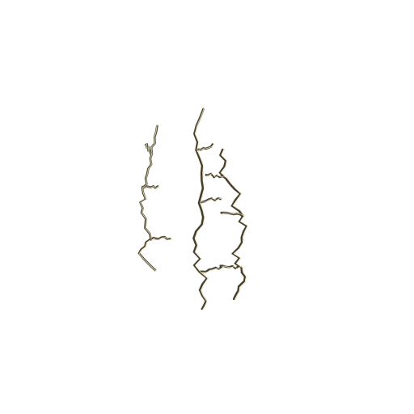
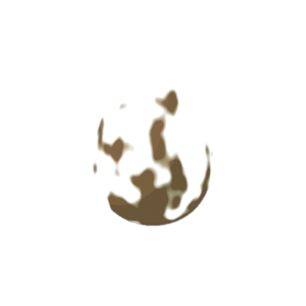
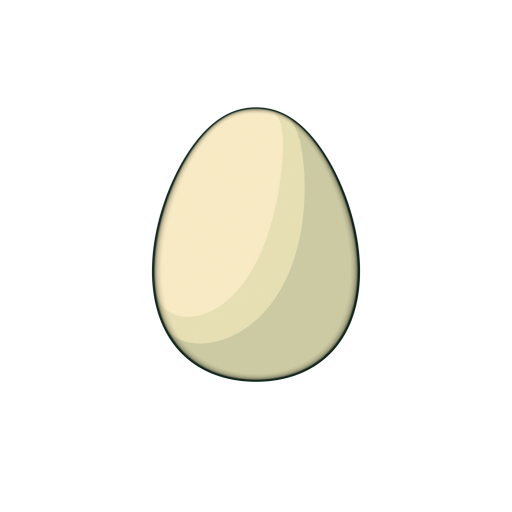

# Eggs and looks

Egg colours, patterns and egg conditions, with how nests and hatching work. Pattern and colour tiers are being reworked (docs/186), so this page always shows the code as it is today.

Generated by `tools/build_catalog.py` from the game code. Do not edit by hand: change the code, then run `python tools/build_catalog.py`.

## Contents

Pages: [Be Dino! team catalogue](Home.md) | [Dinosaurs](Dinosaurs.md) | **Eggs and looks** | [Mutations and fusion](Mutations-and-fusion.md) | [Shop items](Shop-items.md) | [World and food](World-and-food.md)

- [Colours](#colours)
  [Cream](#colour-white) | [Blue](#colour-blue) | [Green](#colour-green) | [Teal](#colour-teal) | [Pink](#colour-pink) | [Amber](#colour-gold) | [Purple](#colour-violet) | [Red](#colour-red) | [Black](#colour-black)
- [Patterns](#patterns)
  [Plain](#pattern-01-blank) | [Dots](#pattern-03-round-spots) | [Freckles](#pattern-08-freckles) | [Patches](#pattern-04-bold-patches) | [Bands](#pattern-05-horizontal-bands) | [Waves](#pattern-06-wavy-stripes) | [Islands](#pattern-02-emerald-islands) | [Diamonds](#pattern-07-diamond-scales)
- [Egg conditions](#conditions)
  [Cracked](#condition-cracked) | [Dirty](#condition-dirty) | [Normal](#condition-normal) | [Rainbow](#condition-rainbow) | [Astra](#condition-astra)
- [Nests and hatching](#nests)

## Colours

Each egg rolls two colours (main and accent), each one on its own with these chances.

| Rarity | Colours | Chance for one slot | Which |
|---|---|---|---|
| Common | 2 | 80.01% | Cream, Blue |
| Uncommon | 1 | 16% | Green |
| Rare | 2 | 3.2% | Teal, Pink |
| Epic | 1 | 0.64% | Amber |
| Legendary | 1 | 0.128% | Purple |
| Mythic | 2 | 0.0256% | Red, Black |

**STATUS** colours need no picture file; the swatch comes from the colour value in the code.

| Colour | Picture | Asset id | Mask | Odds from |
|---|---|---|---|---|
| [Cream](#colour-white) | swatch drawn from the colour value | n/a | n/a | `src/shared/ProgressionConfig.luau` EggColors |
| [Blue](#colour-blue) | swatch drawn from the colour value | n/a | n/a | `src/shared/ProgressionConfig.luau` EggColors |
| [Green](#colour-green) | swatch drawn from the colour value | n/a | n/a | `src/shared/ProgressionConfig.luau` EggColors |
| [Teal](#colour-teal) | swatch drawn from the colour value | n/a | n/a | `src/shared/ProgressionConfig.luau` EggColors |
| [Pink](#colour-pink) | swatch drawn from the colour value | n/a | n/a | `src/shared/ProgressionConfig.luau` EggColors |
| [Amber](#colour-gold) | swatch drawn from the colour value | n/a | n/a | `src/shared/ProgressionConfig.luau` EggColors |
| [Purple](#colour-violet) | swatch drawn from the colour value | n/a | n/a | `src/shared/ProgressionConfig.luau` EggColors |
| [Red](#colour-red) | swatch drawn from the colour value | n/a | n/a | `src/shared/ProgressionConfig.luau` EggColors |
| [Black](#colour-black) | swatch drawn from the colour value | n/a | n/a | `src/shared/ProgressionConfig.luau` EggColors |

### Cream

id: `white`

- **Colour:** `#F7EAC4`
- **Rarity:** Common
- **Chance for one slot:** 40% (1 in 2.5)

### Blue

id: `blue`

- **Colour:** `#2484D3`
- **Rarity:** Common
- **Chance for one slot:** 40% (1 in 2.5)

### Green

id: `green`

- **Colour:** `#1DAF4B`
- **Rarity:** Uncommon
- **Chance for one slot:** 16% (1 in 6.25)

### Teal

id: `teal`

- **Colour:** `#16AA97`
- **Rarity:** Rare
- **Chance for one slot:** 1.6% (1 in 62)

### Pink

id: `pink`

- **Colour:** `#D74893`
- **Rarity:** Rare
- **Chance for one slot:** 1.6% (1 in 62)

### Amber

id: `gold`

- **Colour:** `#F1A024`
- **Rarity:** Epic
- **Chance for one slot:** 0.64% (1 in 156)

### Purple

id: `violet`

- **Colour:** `#9E50CB`
- **Rarity:** Legendary
- **Chance for one slot:** 0.128% (1 in 781)

### Red

id: `red`

- **Colour:** `#ED2C21`
- **Rarity:** Mythic
- **Chance for one slot:** 0.0128% (1 in 7,812)

### Black

id: `black`

- **Colour:** `#1D2229`
- **Rarity:** Mythic
- **Chance for one slot:** 0.0128% (1 in 7,812)

## Patterns

8 patterns (odds version `bd1033-patterns-v1`). The two colours mix by a share from 1 to 99 (uniform mode); matching colours are 100 to 1.

| Pattern | Rarity | Chance per egg |
|---|---|---|
| [Plain](#pattern-01-blank) | Common | 26.68% |
| [Dots](#pattern-03-round-spots) | Common | 26.68% |
| [Freckles](#pattern-08-freckles) | Common | 26.68% |
| [Patches](#pattern-04-bold-patches) | Uncommon | 8.003% |
| [Bands](#pattern-05-horizontal-bands) | Uncommon | 8.003% |
| [Waves](#pattern-06-wavy-stripes) | Rare | 3.201% |
| [Islands](#pattern-02-emerald-islands) | Epic | 0.6402% |
| [Diamonds](#pattern-07-diamond-scales) | Legendary | 0.128% |

**STATUS**

| Pattern | Icon | Asset id | Mask | Odds from |
|---|---|---|---|---|
| [Plain](#pattern-01-blank) | MISSING | no slot in code yet | yes (procedural mask in code) | `src/shared/ProgressionConfig.luau` EggPatterns |
| [Dots](#pattern-03-round-spots) | MISSING | no slot in code yet | yes (procedural mask in code) | `src/shared/ProgressionConfig.luau` EggPatterns |
| [Freckles](#pattern-08-freckles) | MISSING | no slot in code yet | yes (procedural mask in code) | `src/shared/ProgressionConfig.luau` EggPatterns |
| [Patches](#pattern-04-bold-patches) | MISSING | no slot in code yet | yes (procedural mask in code) | `src/shared/ProgressionConfig.luau` EggPatterns |
| [Bands](#pattern-05-horizontal-bands) | MISSING | no slot in code yet | yes (procedural mask in code) | `src/shared/ProgressionConfig.luau` EggPatterns |
| [Waves](#pattern-06-wavy-stripes) | MISSING | no slot in code yet | yes (procedural mask in code) | `src/shared/ProgressionConfig.luau` EggPatterns |
| [Islands](#pattern-02-emerald-islands) | MISSING | no slot in code yet | yes (procedural mask in code) | `src/shared/ProgressionConfig.luau` EggPatterns |
| [Diamonds](#pattern-07-diamond-scales) | MISSING | no slot in code yet | yes (procedural mask in code) | `src/shared/ProgressionConfig.luau` EggPatterns |

### Plain

id: `01_blank`

_No icon yet (see Missing)._

- **Chance:** 26.68% (1 in 3.75) per egg
- **Rarity:** Common

### Dots

id: `03_round_spots`

_No icon yet (see Missing)._

- **Chance:** 26.68% (1 in 3.75) per egg
- **Rarity:** Common

### Freckles

id: `08_freckles`

_No icon yet (see Missing)._

- **Chance:** 26.68% (1 in 3.75) per egg
- **Rarity:** Common

### Patches

id: `04_bold_patches`

_No icon yet (see Missing)._

- **Chance:** 8.003% (1 in 12) per egg
- **Rarity:** Uncommon

### Bands

id: `05_horizontal_bands`

_No icon yet (see Missing)._

- **Chance:** 8.003% (1 in 12) per egg
- **Rarity:** Uncommon

### Waves

id: `06_wavy_stripes`

_No icon yet (see Missing)._

- **Chance:** 3.201% (1 in 31) per egg
- **Rarity:** Rare

### Islands

id: `02_emerald_islands`

_No icon yet (see Missing)._

- **Chance:** 0.6402% (1 in 156) per egg
- **Rarity:** Epic

### Diamonds

id: `07_diamond_scales`

_No icon yet (see Missing)._

- **Chance:** 0.128% (1 in 781) per egg
- **Rarity:** Legendary

## Egg conditions

Chances by condition upgrade tier (version `bd045-conditions-v1`; the owner target is tier 0). Tiers 1 to 6 are PROVISIONAL.

A new player's first 2 eggs are never Cracked.

| Egg upgrade tier | Cracked | Dirty | Normal | Rainbow | Astra | Egg fails |
|---|---|---|---|---|---|---|
| 0 | 50% | 30% | 15% | 4.5% | 0.5% | 40% |
| 1 | 42% | 29% | 22% | 6% | 1% | 33.6% |
| 2 | 34% | 27% | 29% | 8% | 2% | 27.2% |
| 3 | 26% | 24% | 36% | 10.5% | 3.5% | 20.8% |
| 4 | 18% | 21% | 43% | 13% | 5% | 14.4% |
| 5 | 10% | 18% | 49% | 16% | 7% | 8% |
| 6 | 4% | 15% | 52% | 19% | 10% | 3.2% |

**STATUS**

| Condition | Picture | Asset id | Mask | Odds from |
|---|---|---|---|---|
| [Cracked](#condition-cracked) | yes: `resources/eggs/conditions/BeDino_Cond_Cracked.png` | bound | n/a | `src/shared/ProgressionConfig.luau` ConditionWeights |
| [Dirty](#condition-dirty) | yes: `resources/eggs/conditions/BeDino_Cond_Dirty.png` | bound | n/a | `src/shared/ProgressionConfig.luau` ConditionWeights |
| [Normal](#condition-normal) | yes: `resources/ui/v2/icons/premium-egg-normal.png` | bound | n/a | `src/shared/ProgressionConfig.luau` ConditionWeights |
| [Rainbow](#condition-rainbow) | yes: `resources/eggs/conditions/BeDino_Cond_Rainbow.png` | bound | n/a | `src/shared/ProgressionConfig.luau` ConditionWeights |
| [Astra](#condition-astra) | yes: `resources/eggs/conditions/BeDino_Cond_Astra.png` | bound | n/a | `src/shared/ProgressionConfig.luau` ConditionWeights |

Upgrade tiers (shop):

| Tier | Price | Needs |
|---|---|---|
| 1 | 100 crystals | level 3 |
| 2 | 300 crystals | level 8 |
| 3 | 800 crystals | level 16 |
| 4 | 1,800 crystals | level 28 |
| 5 | 4,000 crystals | level 45 |
| 6 | 8,500 crystals | level 60 |

### Cracked

id: `cracked`

- **Strength:** 80% of normal
- **Hatch chance:** 20% (can fail)
- **Chance at tier 0:** 50%

### Dirty

id: `dirty`

- **Strength:** 80% of normal
- **Hatch chance:** 100%
- **Chance at tier 0:** 30%

### Normal

id: `normal`

- **Strength:** 100% of normal
- **Hatch chance:** 100%
- **Chance at tier 0:** 15%

### Rainbow

id: `rainbow`

- **Strength:** 120% of normal
- **Hatch chance:** 100%
- **Chance at tier 0:** 4.5%

### Astra

id: `astra`

- **Strength:** 180% of normal
- **Hatch chance:** 100%
- **Chance at tier 0:** 0.5%

## Nests and hatching

- Eggs from food: 12 eggs per 500 food points (PROVISIONAL). One catch is one egg; one egg is one dino.
- Waiting eggs: 5 in the queue, 10 more in overflow, up to 1,000 banked; a run stops counting at 150 eggs.
- Each good egg gives 1 dinosaur.
- Each egg shows for 1 second(s) when it hatches.
- Nests: 5 spots, 3 hours each, 6 to 12 eggs (PROVISIONAL). A run needs 120 seconds and 1 catch to drop one; one more nest per 30 extra eggs. A nest with no free spot turns into 50 crystals.
- Nest luck: BIG 6%, Shiny 1.5%, +2 condition tiers.
- Shop egg: 150 crystals.
