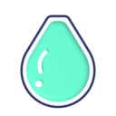
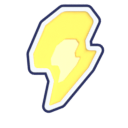
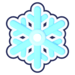
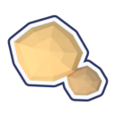
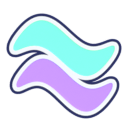
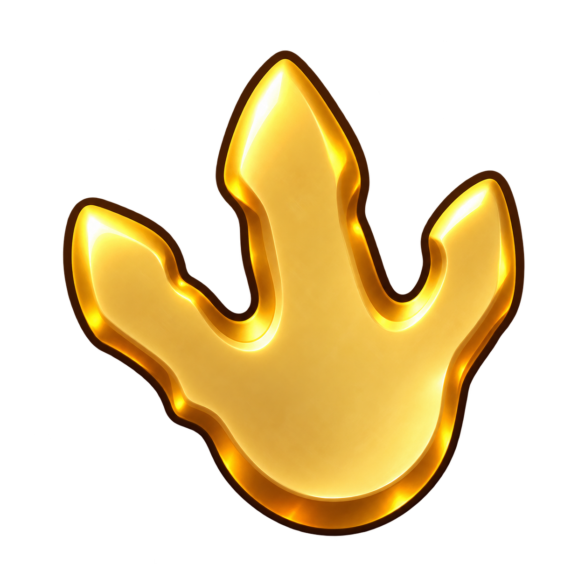

# Mutations and fusion

BIG, Shiny, weather mutations, and the fusion ladder (Gold, Emerald, Diamond).

Generated by `tools/build_catalog.py` from the game code. Do not edit by hand: change the code, then run `python tools/build_catalog.py`.

## Contents

Pages: [Be Dino! team catalogue](Home.md) | [Dinosaurs](Dinosaurs.md) | [Eggs and looks](Eggs-and-looks.md) | **Mutations and fusion** | [Shop items](Shop-items.md) | [World and food](World-and-food.md)

- [BIG and Shiny](#big-and-shiny)
- [Weather mutations](#event-mutations)
  [Dewdrop](#mutation-dewdrop) | [Charged](#mutation-charged) | [Frost](#mutation-frost) | [Seismic](#mutation-seismic) | [Ember](#mutation-ember) | [Aurora](#mutation-aurora) | [Blood Moon](#mutation-bloodmoon)
- [Fusion](#fusion)
  [Gold](#fusion-gold) | [Emerald](#fusion-emerald) | [Diamond](#fusion-diamond)

## BIG and Shiny

- **BIG:** 3% of eggs (1 in 33). The dino is 20% bigger. Size only.
- **Shiny:** 0.6% of earned eggs (1 in 167), only in irregular weather: Volcanic Bloom, Northern Lights, Earthquake, Blood Moon. Bought eggs are never Shiny.

## Weather mutations

A mutation rides on an egg caught in that weather. It gives a small perk and a tint.

**STATUS**

| Mutation | Icon | Asset id | Mask | Odds from |
|---|---|---|---|---|
| [Dewdrop](#mutation-dewdrop) | yes: `resources/ui/v2/icons/mutation-dewdrop-v1.png` | bound | n/a | `src/shared/ProgressionConfig.luau` Weather |
| [Charged](#mutation-charged) | yes: `resources/ui/v2/icons/mutation-charged-v1.png` | bound | n/a | `src/shared/ProgressionConfig.luau` Weather |
| [Frost](#mutation-frost) | yes: `resources/ui/v2/icons/mutation-frost-v1.png` | bound | n/a | `src/shared/ProgressionConfig.luau` Weather |
| [Seismic](#mutation-seismic) | yes: `resources/ui/v2/icons/mutation-seismic-v1.png` | bound | n/a | `src/shared/ProgressionConfig.luau` Weather |
| [Ember](#mutation-ember) | yes: `resources/ui/v2/icons/mutation-ember-v1.png` | bound | n/a | `src/shared/ProgressionConfig.luau` Weather |
| [Aurora](#mutation-aurora) | yes: `resources/ui/v2/icons/mutation-aurora-v1.png` | bound | n/a | `src/shared/ProgressionConfig.luau` Weather |
| [Blood Moon](#mutation-bloodmoon) | yes: `resources/ui/v2/icons/mutation-bloodmoon-v1.png` | bound | n/a | `src/shared/ProgressionConfig.luau` Weather |

### Dewdrop

id: `dewdrop`

- **Growth:** +8%, **speed:** +0% (PROVISIONAL)
- **Colour:** `#55D8B0`; mood: fresh, dewy, playful
- **Comes from:** Rain weather, 2% per egg (1 in 50)

### Charged

id: `charged`

- **Growth:** +0%, **speed:** +10% (PROVISIONAL)
- **Colour:** `#FFDA58`; mood: zippy, bright, tingly
- **Comes from:** Thunderstorm weather, 4% per egg (1 in 25)

### Frost

id: `frost`

- **Growth:** +12%, **speed:** +0% (PROVISIONAL)
- **Colour:** `#87E9FF`; mood: crisp, sparkly, cool
- **Comes from:** Blizzard weather, 4% per egg (1 in 25)

### Seismic

id: `seismic`

- **Growth:** +15%, **speed:** +0% (PROVISIONAL)
- **Colour:** `#DCB473`; mood: warm, sturdy, rumbly
- **Comes from:** Earthquake weather, 5% per egg (1 in 20)

### Ember

id: `ember`

- **Growth:** +18%, **speed:** +4% (PROVISIONAL)
- **Colour:** `#FF743E`; mood: cozy campfire glow
- **Comes from:** Volcanic Bloom weather, 7% per egg (1 in 14)

### Aurora

id: `aurora`

- **Growth:** +12%, **speed:** +8% (PROVISIONAL)
- **Colour:** `#70FFCD`; mood: dreamy, shimmering, magical
- **Comes from:** Northern Lights weather, 7% per egg (1 in 14)

### Blood Moon

id: `bloodmoon`

- **Growth:** +10%, **speed:** +12% (PROVISIONAL)
- **Colour:** `#FF5580`; mood: moody but cozy
- **Comes from:** Blood Moon weather, 8% per egg (1 in 12)

## Fusion

Ladder version `bd057-ladder-6-3-2`. Switch: off in the default build, on in the playtest build.

| Result | Inputs | Rule |
|---|---|---|
| [Gold](#fusion-gold) | 6 x Base | any pattern of the same species |
| [Emerald](#fusion-emerald) | 3 x Gold | same species and same pattern |
| [Diamond](#fusion-diamond) | 2 x Emerald | same species and same pattern |

New traits are rolled from the inputs (PROVISIONAL, version `fusion-odds-provisional-v2`): each chance is 50% (Shiny), 50% (BIG) and 50% (mutation) of the share of such dinos among the inputs.

**STATUS**

| Tier | Icon | Asset id | Mask | Odds from |
|---|---|---|---|---|
| [Gold](#fusion-gold) | yes: `resources/ui/v2/layers/mutation-gold-v1.png` | not bound | n/a | `src/server/IdentityFusion.luau` Recipes |
| [Emerald](#fusion-emerald) | MISSING | not bound | n/a | `src/server/IdentityFusion.luau` Recipes |
| [Diamond](#fusion-diamond) | yes: `resources/ui/v2/layers/mutation-diamond-v1.png` | not bound | n/a | `src/server/IdentityFusion.luau` Recipes |

### Gold

id: `gold`

- **Needs:** 6 Base dinos (any pattern of the same species). All are used up.
- **Result:** one new Gold dino; the next stage is guaranteed.

### Emerald

id: `emerald`

- **Needs:** 3 Gold dinos (same species and same pattern). All are used up.
- **Result:** one new Emerald dino; the next stage is guaranteed.

### Diamond

id: `diamond`

- **Needs:** 2 Emerald dinos (same species and same pattern). All are used up.
- **Result:** one new Diamond dino; the next stage is guaranteed.
