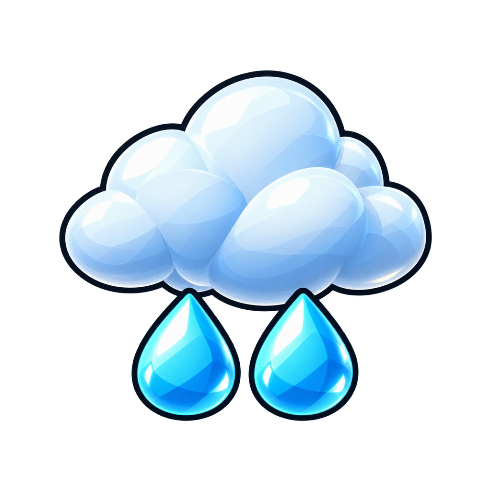
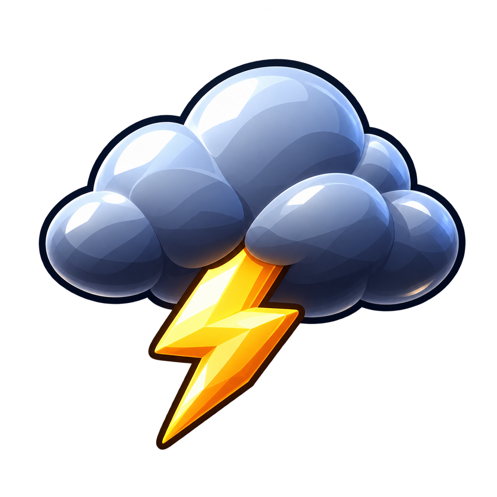
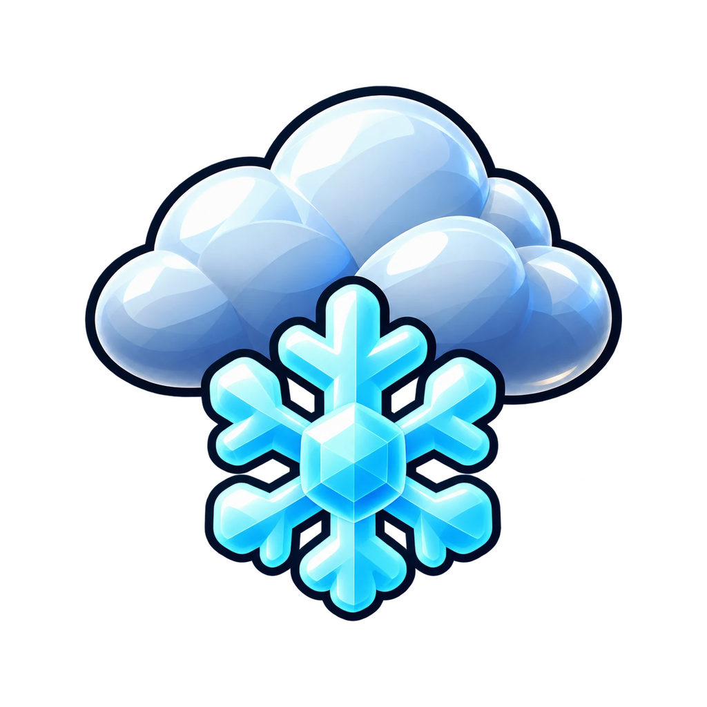
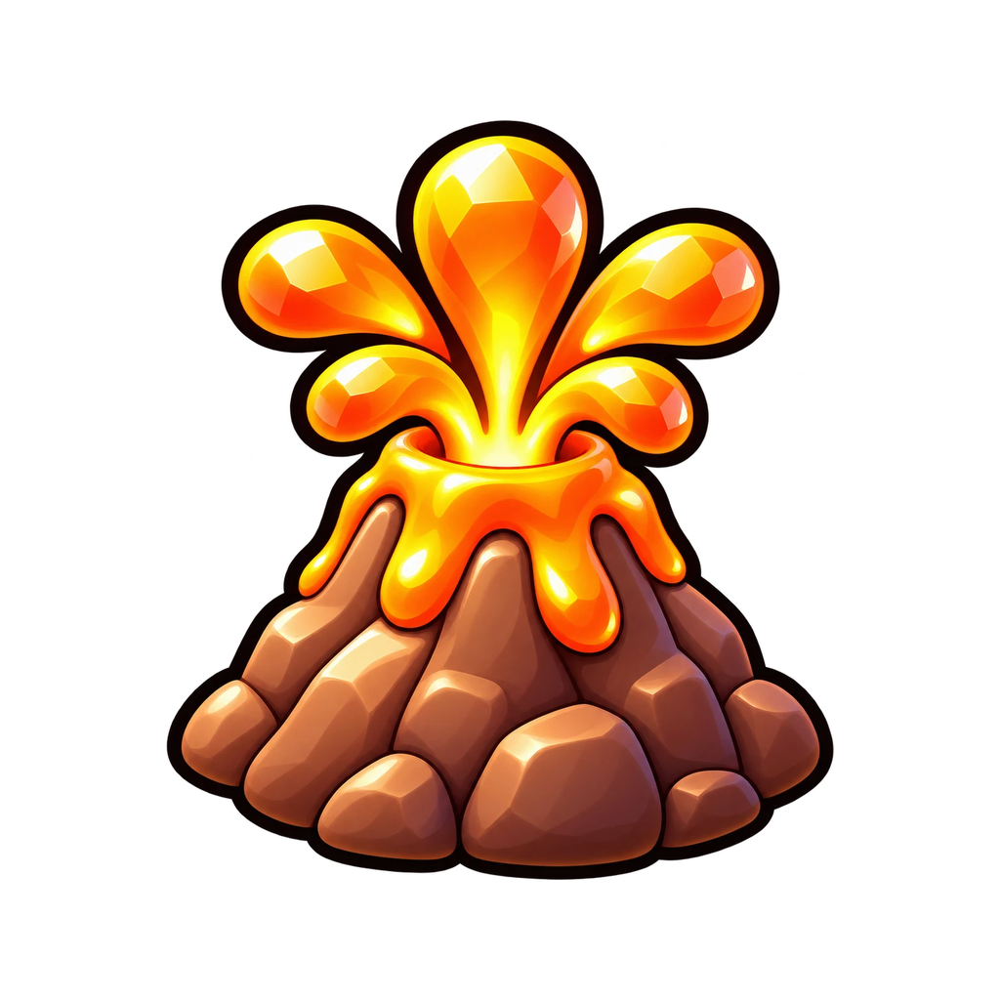
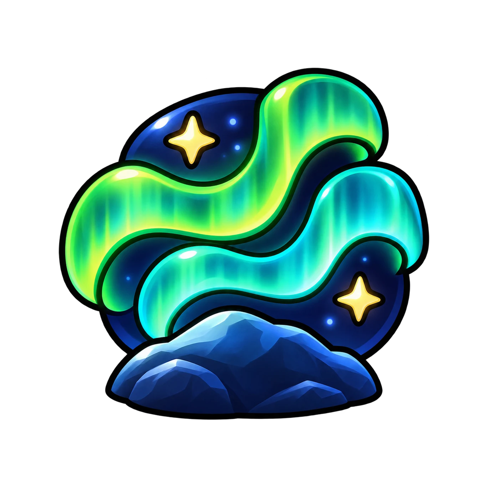
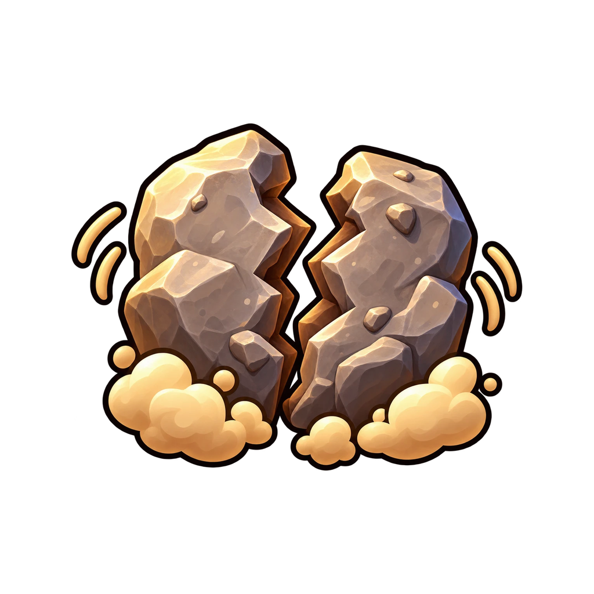
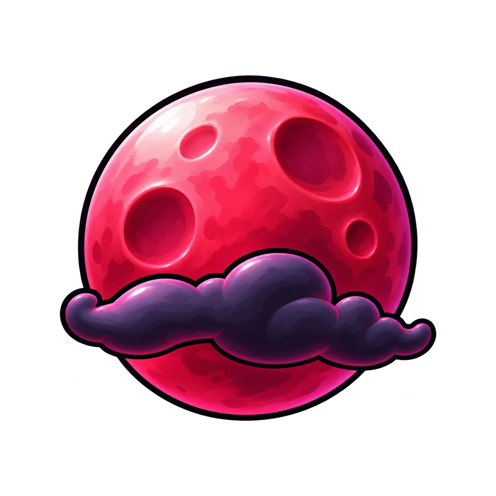

# World and food

Food, weather, biomes, wind and landmarks of the island.

Generated by `tools/build_catalog.py` from the game code. Do not edit by hand: change the code, then run `python tools/build_catalog.py`.

## Contents

Pages: [Be Dino! team catalogue](Home.md) | [Dinosaurs](Dinosaurs.md) | [Eggs and looks](Eggs-and-looks.md) | [Mutations and fusion](Mutations-and-fusion.md) | [Shop items](Shop-items.md) | **World and food**

- [Food](#food)
  [Berry](#food-berry) | [Fruit](#food-fruit) | [Egg](#food-egg) | [Amber](#food-amber)
- [Special food](#special-food)
- [Weather](#weather)
  [Rain](#weather-rain) | [Thunderstorm](#weather-thunder) | [Blizzard](#weather-blizzard) | [Volcanic Bloom](#weather-volcano) | [Northern Lights](#weather-aurora) | [Earthquake](#weather-quake) | [Blood Moon](#weather-bloodmoon)
- [Biomes](#biomes)
  [Meadow](#biome-meadow) | [Fern Forest](#biome-fern) | [Conifer Highlands](#biome-conifer) | [Marsh](#biome-marsh) | [Rocky Badlands](#biome-badlands) | [Volcanic Slopes](#biome-volcanic)
- [Wind](#wind)
- [Landmarks](#landmarks)
  [Dino statue](#landmark-dino-statue) | [Fossil display](#landmark-fossil-display) | [Stone arch](#landmark-stone-arch) | [Ruins altar](#landmark-ruins-altar)
- [Statues in the cave hub](#statues)
  [Brachiosaurus statue](#statue-brachiosaurus) | [T-Rex statue](#statue-trex) | [Triceratops statue](#statue-triceratops)

## Food

Every pickup gives food points (growth and eggs come from them). The island has 400 clusters of 9 pickups.

| Food | Food points | Share |
|---|---|---|
| [Berry](#food-berry) | 1 | 70% |
| [Fruit](#food-fruit) | 4 | 20% |
| [Egg](#food-egg) | 15 | 7% |
| [Amber](#food-amber) | 50 | 3% |

**STATUS**

| Food | Picture | Model | Mask | Points from |
|---|---|---|---|---|
| [Berry](#food-berry) | MISSING | 2 world-kit model(s) in code | n/a | `src/server/FoodService.luau` TYPES |
| [Fruit](#food-fruit) | MISSING | 2 world-kit model(s) in code | n/a | `src/server/FoodService.luau` TYPES |
| [Egg](#food-egg) | MISSING | 2 world-kit model(s) in code | n/a | `src/server/FoodService.luau` TYPES |
| [Amber](#food-amber) | MISSING | 2 world-kit model(s) in code | n/a | `src/server/FoodService.luau` TYPES |

### Berry

id: `berry`

- **Food points:** 1
- **Share of food on the island:** 70%
- **Size:** 0.7 studs

### Fruit

id: `fruit`

- **Food points:** 4
- **Share of food on the island:** 20%
- **Size:** 1 stud

### Egg

id: `egg`

- **Food points:** 15
- **Share of food on the island:** 7%
- **Size:** 1.3 studs

### Amber

id: `amber`

- **Food points:** 50
- **Share of food on the island:** 3%
- **Size:** 1.5 studs

## Special food

### Golden Drumstick

id: `golden_drumstick`

- A giant tasty snack!
- **Food points:** 60 (PROVISIONAL)
- **Chance:** 1% of food slots (1 in 100)
- Picture: MISSING; icon id: not bound; mesh id: not bound. Switch: off in the default build, on in the playtest build.

## Weather

Weather starts every 8 minutes and lasts 3 minutes. Between storms the sky is clear.

| Weather | Rarity | Chance |
|---|---|---|
| [Rain](#weather-rain) | Common | 24% |
| [Thunderstorm](#weather-thunder) | Common | 22% |
| [Blizzard](#weather-blizzard) | Uncommon | 15% |
| [Volcanic Bloom](#weather-volcano) | Rare | 10% |
| [Northern Lights](#weather-aurora) | Legendary | 6% |
| [Earthquake](#weather-quake) | Uncommon | 15% |
| [Blood Moon](#weather-bloodmoon) | Epic | 8% |

**STATUS**

| Weather | Icon | Asset id | Mask | Odds from |
|---|---|---|---|---|
| [Rain](#weather-rain) | yes: `resources/ui/v2/icons/weather-rain-v2.png` | bound | n/a | `src/shared/ProgressionConfig.luau` Weather |
| [Thunderstorm](#weather-thunder) | yes: `resources/ui/v2/icons/weather-thunder-v1.png` | bound | n/a | `src/shared/ProgressionConfig.luau` Weather |
| [Blizzard](#weather-blizzard) | yes: `resources/ui/v2/icons/weather-blizzard-v2.png` | bound | n/a | `src/shared/ProgressionConfig.luau` Weather |
| [Volcanic Bloom](#weather-volcano) | yes: `resources/ui/v2/icons/weather-volcano-v1.png` | bound | n/a | `src/shared/ProgressionConfig.luau` Weather |
| [Northern Lights](#weather-aurora) | yes: `resources/ui/v2/icons/weather-aurora-v1.png` | bound | n/a | `src/shared/ProgressionConfig.luau` Weather |
| [Earthquake](#weather-quake) | yes: `resources/ui/v2/icons/weather-quake-v1.png` | bound | n/a | `src/shared/ProgressionConfig.luau` Weather |
| [Blood Moon](#weather-bloodmoon) | yes: `resources/ui/v2/icons/weather-bloodmoon-v1.png` | bound | n/a | `src/shared/ProgressionConfig.luau` Weather |

### Rain

id: `rain`

- **Rarity:** Common
- **Chance when weather starts:** 24%
- **Growth** +25%, **speed** +0%, **loot** +10%
- **Egg mutation:** Dewdrop at 2% per egg

### Thunderstorm

id: `thunder`

- **Rarity:** Common
- **Chance when weather starts:** 22%
- **Growth** +10%, **speed** +15%, **loot** +40%
- **Egg mutation:** Charged at 4% per egg

### Blizzard

id: `blizzard`

- **Rarity:** Uncommon
- **Chance when weather starts:** 15%
- **Growth** +40%, **speed** +5%, **loot** +25%
- **Egg mutation:** Frost at 4% per egg

### Volcanic Bloom

id: `volcano`

- **Rarity:** Rare
- **Chance when weather starts:** 10%
- **Growth** +20%, **speed** +0%, **loot** +65%
- **Egg mutation:** Ember at 7% per egg (also Shiny)

### Northern Lights

id: `aurora`

- **Rarity:** Legendary
- **Chance when weather starts:** 6%
- **Growth** +30%, **speed** +10%, **loot** +50%
- **Egg mutation:** Aurora at 7% per egg (also Shiny)

### Earthquake

id: `quake`

- **Rarity:** Uncommon
- **Chance when weather starts:** 15%
- **Growth** +10%, **speed** +0%, **loot** +40%
- **Egg mutation:** Seismic at 5% per egg (also Shiny)

### Blood Moon

id: `bloodmoon`

- **Rarity:** Epic
- **Chance when weather starts:** 8%
- **Growth** +15%, **speed** +15%, **loot** +75%
- **Egg mutation:** Blood Moon at 8% per egg (also Shiny)

## Biomes

6 biomes blend smoothly into each other.

**STATUS**

| Biome | Picture | Asset id | Mask | Data from |
|---|---|---|---|---|
| [Meadow](#biome-meadow) | MISSING | n/a | n/a | `src/shared/BiomeMap.luau` |
| [Fern Forest](#biome-fern) | MISSING | n/a | n/a | `src/shared/BiomeMap.luau` |
| [Conifer Highlands](#biome-conifer) | MISSING | n/a | n/a | `src/shared/BiomeMap.luau` |
| [Marsh](#biome-marsh) | MISSING | n/a | n/a | `src/shared/BiomeMap.luau` |
| [Rocky Badlands](#biome-badlands) | MISSING | n/a | n/a | `src/shared/BiomeMap.luau` |
| [Volcanic Slopes](#biome-volcanic) | MISSING | n/a | n/a | `src/shared/BiomeMap.luau` |

### Meadow

id: `meadow`

- **Ground:** grass, leafy grass
- **Rock:** rock

### Fern Forest

id: `fern`

- **Ground:** leafy grass, grass, mud
- **Rock:** rock

### Conifer Highlands

id: `conifer`

- **Ground:** ground, leafy grass, grass
- **Rock:** slate

### Marsh

id: `marsh`

- **Ground:** mud, leafy grass, grass
- **Rock:** mud

### Rocky Badlands

id: `badlands`

- **Ground:** sandstone, sand, ground
- **Rock:** sandstone

### Volcanic Slopes

id: `volcanic`

- **Ground:** basalt, slate, ground
- **Rock:** basalt

## Wind

**Not data-driven yet.** The game has no wind or breeze setting today (trees and grass do not sway). This is listed under Missing on the Home page.

## Landmarks

Big things on the island you can walk up to.

**STATUS**

| Landmark | Picture | Mesh | Mask | Data from |
|---|---|---|---|---|
| [Dino statue](#landmark-dino-statue) | MISSING | mesh bound | n/a | `src/shared/BiomePlacement.luau` Landmarks |
| [Fossil display](#landmark-fossil-display) | MISSING | mesh bound | n/a | `src/shared/BiomePlacement.luau` Landmarks |
| [Stone arch](#landmark-stone-arch) | MISSING | mesh bound | n/a | `src/shared/BiomePlacement.luau` Landmarks |
| [Ruins altar](#landmark-ruins-altar) | MISSING | mesh bound | n/a | `src/shared/BiomePlacement.luau` Landmarks |

### Dino statue

id: `world_landmark_dino_statue`

- **Where:** x 96, z 152
- **Size:** about 19.9 studs tall

### Fossil display

id: `world_landmark_fossil_display`

- **Where:** x -96, z 200
- **Size:** about 9.42 studs tall

### Stone arch

id: `world_landmark_stone_arch`

- **Where:** x 240, z -272
- **Size:** about 25.8 studs tall

### Ruins altar

id: `world_landmark_ruins_altar`

- **Where:** x -64, z -192
- **Size:** about 12.6 studs tall

## Statues in the cave hub

Switch: off in the default build, on in the playtest build.

**STATUS**

| Statue | Picture | Model id | Mask | Data from |
|---|---|---|---|---|
| [Brachiosaurus statue](#statue-brachiosaurus) | MISSING | model bound | n/a | `src/shared/CaveHubProps.luau` |
| [T-Rex statue](#statue-trex) | MISSING | model bound | n/a | `src/shared/CaveHubProps.luau` |
| [Triceratops statue](#statue-triceratops) | MISSING | model bound | n/a | `src/shared/CaveHubProps.luau` |

### Brachiosaurus statue

id: `hub_statue_brachiosaurus`

- index statue, x2.5

### T-Rex statue

id: `hub_statue_trex`

- index statue, x1.9

### Triceratops statue

id: `hub_statue_triceratops`

- index statue
