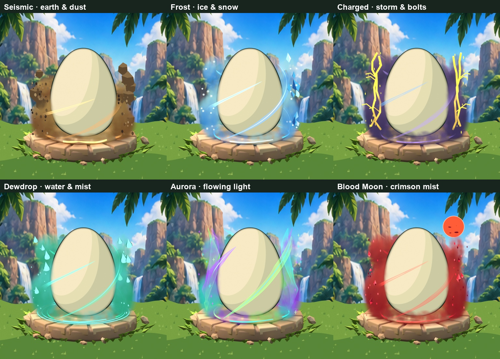
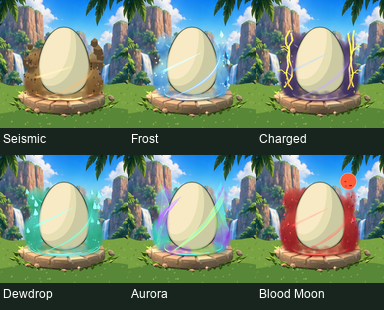

# Six elemental auras following the preferred Magma direction

**Owner approval, 2026-10-13:** all six displayed designs are visually approved. Preserve Seismic, Frost, Charged, Dewdrop, Aurora, and Blood Moon as shown. The earlier awaiting-review language below describes the original render batch; approval supersedes it. This approval covers appearance, not granular export completion, runtime animation, or Studio/device acceptance. Next work is packaging and combination testing, rather than unsolicited art redesign.

The owner preferred the refined Magma with yellow heat, orange smoke, and finer dark debris, then requested more mutations. These six new visual revisions follow the existing Seismic, Frost, Charged, Dewdrop, Aurora, and Blood Moon entries. They are **awaiting owner review**; no new catalog IDs, eligibility rules, probabilities, or gameplay perks are introduced.

| Mutation | Identity |
|---|---|
| Seismic | Low ochre/umber dust, irregular sandstone chunks, angular fine chips, broken floor shock orbit |
| Frost | Cyan/blue mist, elongated ice shards, six-arm snow crystals, cool light cores |
| Charged | Violet/blue storm smoke, branching gold bolts with pale cores, electrical sparks |
| Dewdrop | Teal/green mist, sculpted droplets, tiny drifting drops, mint highlights, ground ripples |
| Aurora | Mint/cyan/violet smoke, broader wrapping silk and rising light curtains, small colored glints |
| Blood Moon | Crimson/wine smoke, separate red moon with crater caps/rim, ruby shards and drifting ash |

The original blank egg, stone tile, matching grass, jungle backdrop, and locked camera are preserved. Smoke/geometry sits around the egg, including rear and lower foreground depth, instead of being a shell paint treatment. Each family has separately editable Smoke, Wisps, Element accents, Particles, and Ground collections. Preferred Magma and all earlier drafts stay intact.

Twelve internal 1024px renders produce twelve actual 512px RGBA PNGs: one scene preview and one transparent effect-only aura per mutation. Effect renders use egg holdout and include compositor bloom. They contain no opaque replacement shell. Granular component PNGs and separate rear/front animation packs for the new six remain later delivery work.

[Validation](validation.json) records resolution/alpha, transparent corners, preserved vertex hash, identical camera transform, and unchanged base pixels outside effects in green/blue and black static layer checks. This bounded authoring review does not certify every pattern/condition/Shiny/Big combination or Studio phone performance. [Hashes and provenance](manifest.json).

Local editable source: `Premium_Egg/Mutation_Family_Refined/BeDino_Mutation_Family_Refined.blend`; pre-build backup: `BeDino_Mutations_PreBuild_Backup.blend`. Collections 220–225 hold the six new families. Full projects and individual export packs remain local, not downloadable from this evidence directory.
