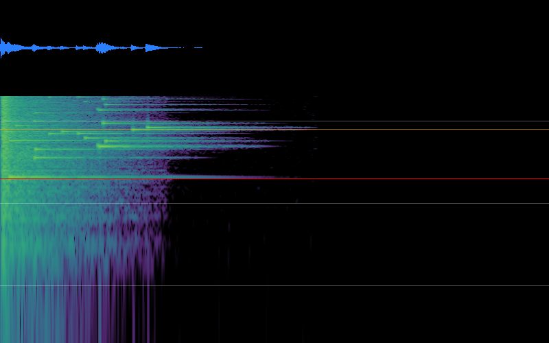
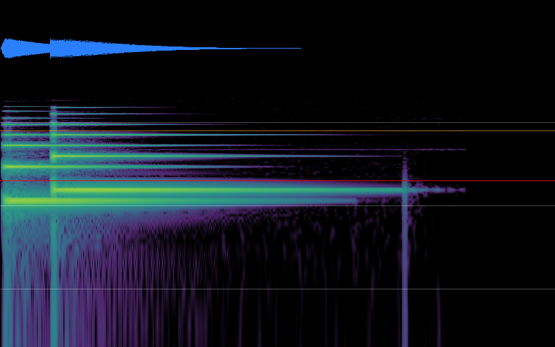
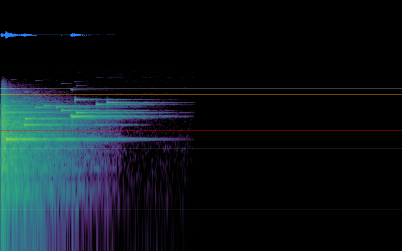

## Per-file numbers
| file | dur s | Hz | ch | peak dBFS | true pk | RMS dB | LUFS-M max | LUFS-I | clip runs | lead s | tail s | attack ms | decay ms | crest dB | main Hz | centroid Hz | harsh | verdict |
|---|---|---|---|---|---|---|---|---|---|---|---|---|---|---|---|---|---|---|
| shop_buy.wav | 0.80 | 44100 | 1 | -3.0 | -2.1 | -17.2 | -12.8 | -14.6 | 0 | 0.00 | 0.24 | 70.7 | 196 | 14.2 | 2093 | 6057 | 60 | harsh |
| shiny_bang.wav | 1.70 | 44100 | 1 | -3.0 | -2.2 | -25.5 | -20.1 | -23.0 | 0 | 0.00 | 0.96 | 3.4 | 486 | 22.5 | 2093 | 6783 | 98 | harsh |
| shop_buy_soft.wav | 1.07 | 44100 | 1 | -6.2 | -6.0 | -20.3 | -15.5 | -17.9 | 0 | 0.00 | 0.32 | 93.7 | 302 | 14.0 | 1570 | 2328 | 27 | ok |
| shiny_bang_soft.wav | 2.43 | 44100 | 1 | -13.3 | -13.3 | -31.3 | -26.9 | -29.7 | 0 | 0.00 | 1.54 | 31.6 | 507 | 17.9 | 1466 | 2162 | 31 | calm |

## Energy per band
| file | sub % | low % | mid % | presence % | high % | air % | above 2 kHz % |
|---|---|---|---|---|---|---|---|
| shop_buy.wav | 0 | 0 | 11 | 31 | 24 | 34 | 89 |
| shiny_bang.wav | 0 | 0 | 0 | 38 | 28 | 34 | 100 |
| shop_buy_soft.wav | 0 | 0 | 68 | 25 | 7 | 0 | 32 |
| shiny_bang_soft.wav | 0 | 0 | 64 | 34 | 1 | 0 | 36 |

## Verdicts and notes
- **shop_buy.wav**: harsh (harshness 60 (89% of the energy is above 2 kHz, attack 70.7 ms); loudest 400 ms is -12.8 LUFS (limit -14)). Notes: 34% of the energy is above 8 kHz (docs/110 style rule 2 says none)
- **shiny_bang.wav**: harsh (harshness 98 (100% of the energy is above 2 kHz, attack 3.4 ms)). Notes: 0.96 s of silent tail (trim it); very fast attack (3.4 ms): a snap or click; 34% of the energy is above 8 kHz (docs/110 style rule 2 says none)
- **shop_buy_soft.wav**: ok (-15.5 LUFS)
- **shiny_bang_soft.wav**: calm (-26.9 LUFS, soft top end). Notes: 1.54 s of silent tail (trim it)

## Pictures (top: waveform; bottom: spectrogram, low pitch at the bottom; red line = 2 kHz, orange = 8 kHz, white = 100 Hz / 1 kHz / 10 kHz)

**shop_buy.wav**

**shiny_bang.wav**

**shop_buy_soft.wav**

**shiny_bang_soft.wav**

