# Audio report, SFX pack, 2026-10-18 (BD-637, BD-166)

Made by `python tools/audio_report.py assets/audio/sfx --game src/shared/Sfx.luau --compare --out docs/evidence/2026-10-18-audio-report --md ...`. What the tool can and cannot say: [docs/161](../../161-audio-analysis-tool.md). **Nobody listened to anything.** Numbers flag loud, harsh, clipped, inconsistent and silent; they do not say "nice". All thresholds are provisional (one table at the top of the tool). No game audio file, volume or asset id was changed; every change below is a suggestion for the owner.

## Plain-words summary

- **Nothing in the pack clips** (all 17 files peak at -3 dBFS; two have a true peak of about -2 dBTP, fine).
- **Every file is normalised to the same peak, so file loudness differs by how dense the sound is**: the loudest 0.4 s runs from -12.8 LUFS (shop_buy) to -26.1 (ui_click, hatch_crack). Three files are 4+ LU above the pack median (shop_buy, weather_start, level_up) and are flagged loud.
- **Two files are harsh** (shiny_bang, shop_buy): almost all their energy is above 2 kHz, and a third of it is above 8 kHz, which docs/110 style rule 2 says should be none.
- In the game, cue volumes pull most of this back. At the level the player gets (before the sliders), the loud outliers are the three legendary/epic reveals (-16 to -17 LUFS) and everything else sits between -20 and -34.

## BD-166 (loud sharp sound at run end): the likely culprit from the numbers

What fires around the run end (from `Bootstrap.client.luau`): `run_end` automatically; `level_up` automatically when the run gives a level (and again when a bonus nest opens); `shop_buy` when the player taps a bonus nest. Crystal rewards have no sound of their own (`crystal_cue` has no asset id).

| Cue (volume) | Player level, LUFS-M | File loudness vs pack | Above 2 kHz / above 8 kHz | Attack | Harsh | Note |
|---|---:|---|---|---|---:|---|
| run_end, before the 2026-10-16 fix (old 3-note file, vol .3, rate .92) | -25.1 | +3.1 LU | 0% / 0% | 3.8 ms | 22 | loud as a file, but quiet in game and not bright |
| run_end, now (run_start chime, vol .2, rate .9) | -28.0 | quiet in game | 2% / 1% | 9.7 ms | 9 | calm: not the culprit any more |
| **level_up** (vol .4, rate .95) | **-21.4** | +4.3 LU (outlier) | 9% / 0% | 2.8 ms | 25 | **loudest automatic cue at run end, 7 LU above run_end**; plays a second time when a nest opens |
| **shop_buy** (vol .35) | -21.9 | **+5.0 LU (loudest file, outlier)** | **89% / 34%** | 70 ms | **60** | harshest cue the player can reach right after a run; a 2 kHz coin ring with a bright top; true peak -2.1 dBTP |
| shiny_bang (vol .8) | -22.1 | -2.4 LU | 100% / 34% | 3.4 ms | 98 | sharpest of all, but only on a Shiny reveal |

(Asset id 127962506254484, the pre-fix run_end, is `run_end.wav` per [docs/77](../../77-asset-registry.md); the other rows read the current `Sfx.luau`.)

**Most likely culprit: `shop_buy`** for the "sharp" half (89% of its energy above 2 kHz, 34% above 8 kHz, the loudest file in the pack, +5 LU over the median), reached when the player taps a bonus nest right after the run. **`level_up`** is the likely culprit for the "loud" half: it is the loudest cue that plays by itself at run end and stacks a second time with a nest. The old `run_end` sting was NOT sharp by the numbers (no energy above 2 kHz) and is now 7 LU quieter. Caveat: only the owner's ears can say which sound was heard; if the complaint came from a run where a Shiny hatched, `shiny_bang` is the single harshest cue in the pack.

### Suggested changes (suggestions only, nothing applied)

Evidence: temporary ffmpeg copies in a scratch folder, re-measured with this tool (not committed).

| Cue | Suggestion | Measured effect |
|---|---|---|
| shop_buy | Play at **rate .75** (pitch down about 5 semitones, a number in `Sfx.luau`, no re-upload) AND cut everything above 5 kHz by about 9 dB (a new render, or a Roblox EqualizerSoundEffect on the Sound), plus a 10 ms fade-in. Optionally volume .35 to .25. | harsh 60 to **37 (ok)**; above 2 kHz 89% to 41%; above 8 kHz 34% to 3%; file loudness -12.8 to -15.4 LUFS-M (player level -21.9 to -24.5 at vol .35). Rate .75 alone, or a 4 kHz low-pass alone, leaves harsh at 60 (the 2 kHz fundamental is the problem), so use both. |
| level_up | Volume **.4 to .3** (about -2.5 LU) and a 10 ms fade-in. Trim 0.5 s of silent tail. | player level -21.4 to about -23.9, back to the pack median (-22.3); harsh 25 to 15 with the fade-in. |
| shiny_bang | Needs a re-render with its energy moved below 5 kHz. Rate .75 plus a 9 dB shelf above 5 kHz only brings harsh from 98 to 74 (still harsh). | not fixable with a filter alone. |
| hatch_legendary, hatch_reveal_epic, hatch_reveal_legendary | Optional: volume down to .7 puts them about 2 LU lower (about -18.3 LUFS-M player level). Rare payoffs, low priority. | the 3 loud outliers drop to the "ok" band. |

Check any new render with `python tools/audio_report.py <new files> --compare` before the owner listens. Not suggested: any change to `run_end` (already soft).

## Pack-wide notes

- The tail of every reverb-style file (hatch_rare, shiny_bang, level_up, shop_refresh) has 0.5 to 1 s below -60 dBFS: harmless in game, but trimming saves size and stops a queued cue waiting on silence.
- Quiet outliers in the "player level" list (pickups, ui_click, hatch_crack) are by design: frequent short cues.
- Pitch rate and per-play jitter are not in these numbers.


# Full numbers

## Per-file numbers
| file | dur s | Hz | ch | peak dBFS | true pk | RMS dB | LUFS-M max | LUFS-I | clip runs | lead s | tail s | attack ms | decay ms | crest dB | main Hz | centroid Hz | harsh | verdict |
|---|---|---|---|---|---|---|---|---|---|---|---|---|---|---|---|---|---|---|
| big_thud.wav | 0.60 | 44100 | 1 | -3.0 | -3.0 | -17.7 | -18.6 | -20.9 | 0 | 0.00 | 0.00 | 9.9 | 297 | 14.7 | 56 | 85 | 17 | ok |
| fusion_reveal.wav | 2.40 | 44100 | 1 | -3.0 | -3.0 | -21.9 | -17.8 | -22.3 | 0 | 0.00 | 0.51 | 1234.4 | 343 | 18.9 | 51 | 473 | 0 | ok |
| hatch_common.wav | 0.75 | 44100 | 1 | -3.0 | -3.0 | -15.6 | -18.1 | -20.7 | 0 | 0.00 | 0.50 | 3.8 | 92 | 12.6 | 660 | 662 | 20 | ok |
| hatch_crack.wav | 0.45 | 44100 | 1 | -3.0 | -2.7 | -26.6 | -26.1 | -26.1 | 0 | 0.00 | 0.11 | 190.0 | 124 | 23.6 | 420 | 3258 | 27 | calm |
| hatch_legendary.wav | 2.45 | 44100 | 1 | -3.0 | -3.0 | -19.8 | -15.2 | -18.6 | 0 | 0.00 | 0.43 | 1157.5 | 320 | 16.7 | 524 | 658 | 0 | ok |
| hatch_rare.wav | 1.45 | 44100 | 1 | -3.0 | -3.0 | -17.6 | -15.5 | -18.1 | 0 | 0.00 | 0.75 | 163.4 | 234 | 14.6 | 494 | 725 | 0 | ok |
| level_up.wav | 1.40 | 44100 | 1 | -3.0 | -3.0 | -16.7 | -13.5 | -16.2 | 0 | 0.00 | 0.59 | 2.8 | 334 | 13.7 | 1046 | 1134 | 25 | loud |
| pickup.wav | 0.14 | 44100 | 1 | -3.0 | -3.0 | -16.8 | -23.4 | -23.4 | 0 | 0.00 | 0.06 | 2.4 | 34 | 13.8 | 1046 | 1049 | 26 | ok |
| pickup_hi.wav | 0.14 | 44100 | 1 | -3.0 | -3.0 | -16.8 | -22.6 | -22.6 | 0 | 0.00 | 0.06 | 2.4 | 34 | 13.8 | 1318 | 1322 | 26 | ok |
| pickup_lo.wav | 0.14 | 44100 | 1 | -3.0 | -3.0 | -16.7 | -23.7 | -23.7 | 0 | 0.00 | 0.06 | 2.4 | 34 | 13.7 | 831 | 833 | 26 | ok |
| run_end.wav | 1.10 | 44100 | 1 | -3.0 | -3.0 | -16.0 | -14.6 | -17.8 | 0 | 0.00 | 0.49 | 3.8 | 281 | 13.0 | 784 | 607 | 22 | ok |
| run_start.wav | 0.50 | 44100 | 1 | -3.0 | -2.9 | -13.4 | -14.0 | -15.7 | 0 | 0.00 | 0.11 | 9.7 | 67 | 10.4 | 784 | 677 | 9 | ok |
| shiny_bang.wav | 1.70 | 44100 | 1 | -3.0 | -2.2 | -25.5 | -20.1 | -23.0 | 0 | 0.00 | 0.96 | 3.4 | 486 | 22.5 | 2093 | 6783 | 98 | harsh |
| shop_buy.wav | 0.80 | 44100 | 1 | -3.0 | -2.1 | -17.2 | -12.8 | -14.6 | 0 | 0.00 | 0.24 | 70.7 | 196 | 14.2 | 2093 | 6057 | 60 | harsh |
| shop_refresh.wav | 1.40 | 44100 | 1 | -3.0 | -3.0 | -17.9 | -14.4 | -17.3 | 0 | 0.00 | 0.69 | 143.3 | 226 | 14.9 | 1319 | 1421 | 0 | ok |
| ui_click.wav | 0.05 | 44100 | 1 | -3.0 | -3.0 | -19.3 | -26.1 | -26.1 | 0 | 0.00 | 0.03 | 1.4 | 11 | 16.3 | 1900 | 2222 | 34 | calm |
| weather_start.wav | 1.80 | 44100 | 1 | -3.0 | -3.0 | -17.9 | -13.2 | -15.7 | 0 | 0.03 | 0.03 | 895.8 | 587 | 14.9 | 294 | 2283 | 22 | loud |

## Energy per band
| file | sub % | low % | mid % | presence % | high % | air % | above 2 kHz % |
|---|---|---|---|---|---|---|---|
| big_thud.wav | 96 | 3 | 1 | 0 | 0 | 0 | 0 |
| fusion_reveal.wav | 46 | 20 | 33 | 1 | 0 | 1 | 1 |
| hatch_common.wav | 0 | 0 | 100 | 0 | 0 | 0 | 0 |
| hatch_crack.wav | 0 | 10 | 57 | 12 | 7 | 14 | 33 |
| hatch_legendary.wav | 0 | 25 | 73 | 2 | 0 | 0 | 2 |
| hatch_rare.wav | 0 | 6 | 90 | 3 | 0 | 0 | 4 |
| level_up.wav | 0 | 0 | 91 | 9 | 0 | 0 | 9 |
| pickup.wav | 0 | 0 | 100 | 0 | 0 | 0 | 0 |
| pickup_hi.wav | 0 | 0 | 100 | 0 | 0 | 0 | 0 |
| pickup_lo.wav | 0 | 0 | 100 | 0 | 0 | 0 | 0 |
| run_end.wav | 0 | 32 | 68 | 0 | 0 | 0 | 0 |
| run_start.wav | 0 | 28 | 71 | 1 | 0 | 1 | 2 |
| shiny_bang.wav | 0 | 0 | 0 | 38 | 28 | 34 | 100 |
| shop_buy.wav | 0 | 0 | 11 | 31 | 24 | 34 | 89 |
| shop_refresh.wav | 0 | 0 | 91 | 9 | 0 | 0 | 9 |
| ui_click.wav | 0 | 0 | 95 | 2 | 1 | 2 | 5 |
| weather_start.wav | 0 | 49 | 23 | 15 | 5 | 8 | 28 |

## Verdicts and notes
- **big_thud.wav**: ok (-18.6 LUFS)
- **fusion_reveal.wav**: ok (-17.8 LUFS). Notes: 0.51 s of silent tail (trim it)
- **hatch_common.wav**: ok (-18.1 LUFS). Notes: very fast attack (3.8 ms): a snap or click
- **hatch_crack.wav**: calm (-26.1 LUFS, soft top end). Notes: 14% of the energy is above 8 kHz (docs/110 style rule 2 says none)
- **hatch_legendary.wav**: ok (-15.2 LUFS)
- **hatch_rare.wav**: ok (-15.5 LUFS). Notes: 0.75 s of silent tail (trim it)
- **level_up.wav**: loud (loudest 400 ms is -13.5 LUFS (limit -14)). Notes: 0.59 s of silent tail (trim it); very fast attack (2.8 ms): a snap or click
- **pickup.wav**: ok (-23.4 LUFS). Notes: very fast attack (2.4 ms): a snap or click
- **pickup_hi.wav**: ok (-22.6 LUFS). Notes: very fast attack (2.4 ms): a snap or click
- **pickup_lo.wav**: ok (-23.7 LUFS). Notes: very fast attack (2.4 ms): a snap or click
- **run_end.wav**: ok (-14.6 LUFS). Notes: very fast attack (3.8 ms): a snap or click
- **run_start.wav**: ok (-14.0 LUFS)
- **shiny_bang.wav**: harsh (harshness 98 (100% of the energy is above 2 kHz, attack 3.4 ms)). Notes: 0.96 s of silent tail (trim it); very fast attack (3.4 ms): a snap or click; 34% of the energy is above 8 kHz (docs/110 style rule 2 says none)
- **shop_buy.wav**: harsh (harshness 60 (89% of the energy is above 2 kHz, attack 70.7 ms); loudest 400 ms is -12.8 LUFS (limit -14)). Notes: 34% of the energy is above 8 kHz (docs/110 style rule 2 says none)
- **shop_refresh.wav**: ok (-14.4 LUFS). Notes: 0.69 s of silent tail (trim it)
- **ui_click.wav**: calm (-26.1 LUFS, soft top end). Notes: very fast attack (1.4 ms): a snap or click
- **weather_start.wav**: loud (loudest 400 ms is -13.2 LUFS (limit -14)). Notes: 8% of the energy is above 8 kHz (docs/110 style rule 2 says none)

## Compare
```
Loudness of the files themselves (LUFS-M max); pack median -17.8 LUFS; outlier = 4 LU or more from the median.
  shop_buy.wav              -12.8 LUFS  (+5.0 LU)  <-- OUTLIER +5.0 LU
  weather_start.wav         -13.2 LUFS  (+4.6 LU)  <-- OUTLIER +4.6 LU
  level_up.wav              -13.5 LUFS  (+4.3 LU)  <-- OUTLIER +4.3 LU
  run_start.wav             -14.0 LUFS  (+3.8 LU)
  shop_refresh.wav          -14.4 LUFS  (+3.4 LU)
  run_end.wav               -14.6 LUFS  (+3.1 LU)
  hatch_legendary.wav       -15.2 LUFS  (+2.6 LU)
  hatch_rare.wav            -15.5 LUFS  (+2.3 LU)
  fusion_reveal.wav         -17.8 LUFS  (+0.0 LU)
  hatch_common.wav          -18.1 LUFS  (-0.4 LU)
  big_thud.wav              -18.6 LUFS  (-0.8 LU)
  shiny_bang.wav            -20.1 LUFS  (-2.4 LU)
  pickup_hi.wav             -22.6 LUFS  (-4.9 LU)  <-- OUTLIER -4.9 LU
  pickup.wav                -23.4 LUFS  (-5.7 LU)  <-- OUTLIER -5.7 LU
  pickup_lo.wav             -23.7 LUFS  (-5.9 LU)  <-- OUTLIER -5.9 LU
  ui_click.wav              -26.1 LUFS  (-8.3 LU)  <-- OUTLIER -8.3 LU
  hatch_crack.wav           -26.1 LUFS  (-8.3 LU)  <-- OUTLIER -8.3 LU
Harshness outliers (score 20 or more above the pack median 22): shiny_bang.wav 98, shop_buy.wav 60

Level the PLAYER gets (file LUFS-M max + 20*log10(cue volume), before the Master/SFX sliders); median -22.3 LUFS.
  hatch_reveal_legendary    -16.1 LUFS  vol 0.90  plays hatch_legendary   2.2 s  harsh   0  loud  <-- OUTLIER +6.2 LU
  hatch_legendary           -16.6 LUFS  vol 0.85  plays hatch_legendary   2.5 s  harsh   0  loud  <-- OUTLIER +5.7 LU
  hatch_reveal_epic         -16.9 LUFS  vol 0.82  plays hatch_legendary   2.3 s  harsh   0  loud  <-- OUTLIER +5.3 LU
  hatch_reveal_rare         -18.3 LUFS  vol 0.72  plays hatch_rare        1.4 s  harsh   0  ok
  hatch_rare                -18.6 LUFS  vol 0.70  plays hatch_rare        1.4 s  harsh   0  ok
  fusion_reveal             -20.3 LUFS  vol 0.75  plays fusion_reveal     2.4 s  harsh   0  ok
  big_thud                  -20.5 LUFS  vol 0.80  plays big_thud          0.6 s  harsh  17  ok
  shop_refresh              -21.4 LUFS  vol 0.45  plays shop_refresh      1.4 s  harsh   0  ok
  level_up                  -21.4 LUFS  vol 0.40  plays level_up          1.5 s  harsh  25  ok
  shop_buy                  -21.9 LUFS  vol 0.35  plays shop_buy          0.8 s  harsh  60  harsh
  shiny_bang                -22.1 LUFS  vol 0.80  plays shiny_bang        1.7 s  harsh  98  harsh
  hatch_reveal_uncommon     -22.3 LUFS  vol 0.62  plays hatch_common      0.8 s  harsh  20  ok
  hatch_common              -22.6 LUFS  vol 0.60  plays hatch_common      0.8 s  harsh  20  ok
  hatch_reveal_common       -24.2 LUFS  vol 0.50  plays hatch_common      0.8 s  harsh  20  ok
  run_start                 -26.1 LUFS  vol 0.25  plays run_start         0.5 s  harsh   9  calm
  weather_start             -27.2 LUFS  vol 0.20  plays weather_start     1.8 s  harsh  22  calm  <-- OUTLIER -4.9 LU
  run_end                   -28.0 LUFS  vol 0.20  plays run_start         0.6 s  harsh   9  calm  <-- OUTLIER -5.7 LU
  hatch_crack               -30.6 LUFS  vol 0.60  plays hatch_crack       0.5 s  harsh  27  calm  <-- OUTLIER -8.3 LU
  hatch_crack_stage         -30.6 LUFS  vol 0.60  plays hatch_crack       0.5 s  harsh  27  calm  <-- OUTLIER -8.3 LU
  pickup_hi                 -31.8 LUFS  vol 0.35  plays pickup_hi         0.1 s  harsh  26  calm  <-- OUTLIER -9.5 LU
  pickup                    -32.6 LUFS  vol 0.35  plays pickup            0.1 s  harsh  26  calm  <-- OUTLIER -10.3 LU
  pickup_lo                 -32.8 LUFS  vol 0.35  plays pickup_lo         0.1 s  harsh  26  calm  <-- OUTLIER -10.5 LU
  ui_click                  -34.0 LUFS  vol 0.40  plays ui_click          0.1 s  harsh  34  calm  <-- OUTLIER -11.7 LU
```

## Pictures (top: waveform; bottom: spectrogram, low pitch at the bottom; red line = 2 kHz, orange = 8 kHz, white = 100 Hz / 1 kHz / 10 kHz)

**big_thud.wav**

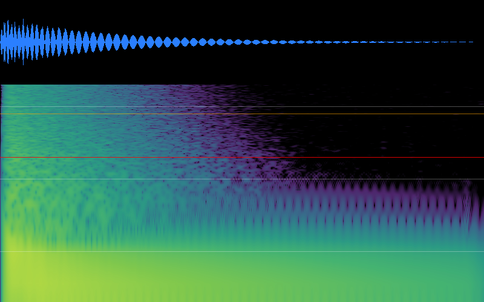

**fusion_reveal.wav**

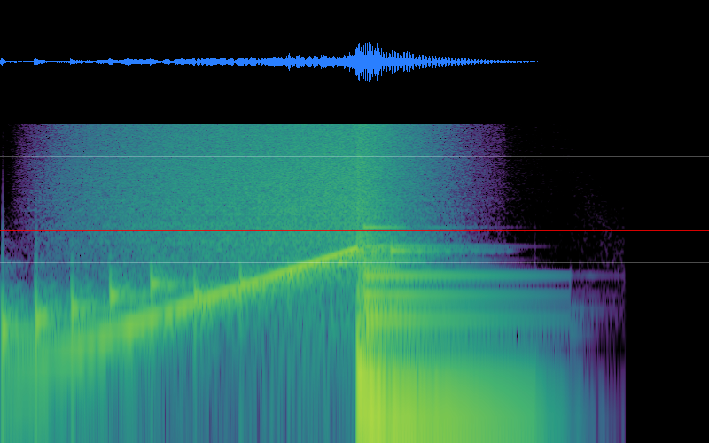

**hatch_common.wav**

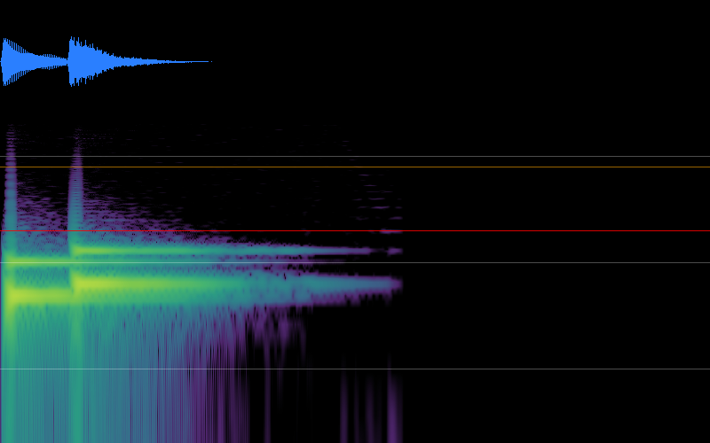

**hatch_crack.wav**

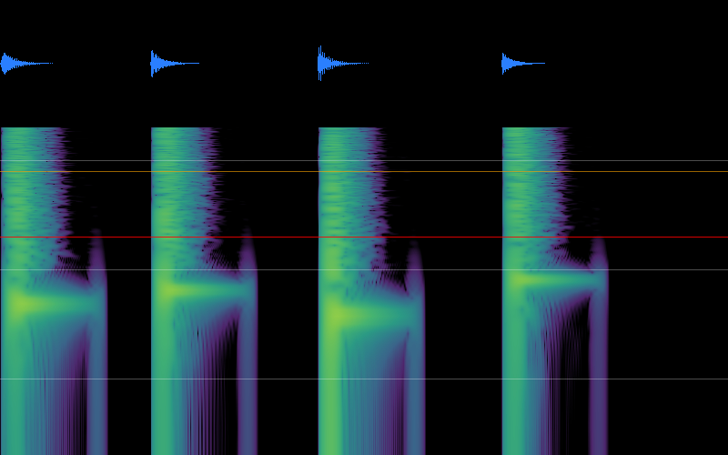

**hatch_legendary.wav**

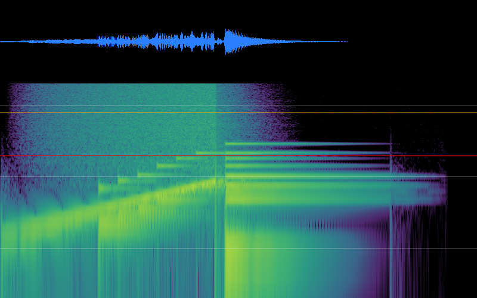

**hatch_rare.wav**

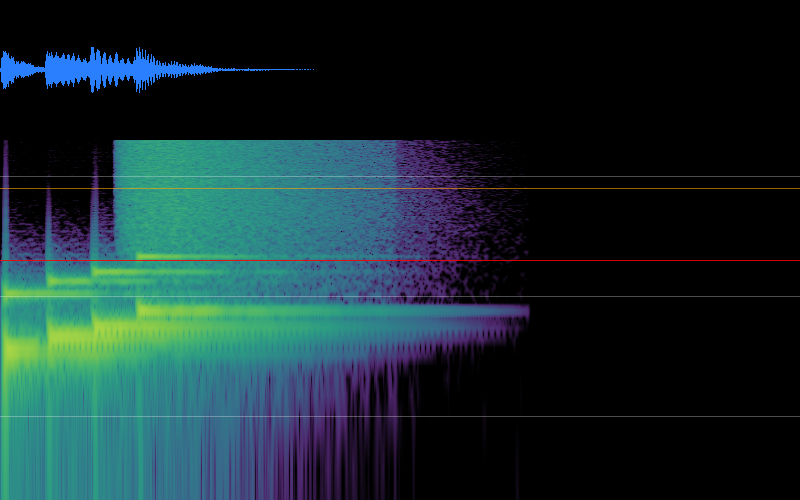

**level_up.wav**

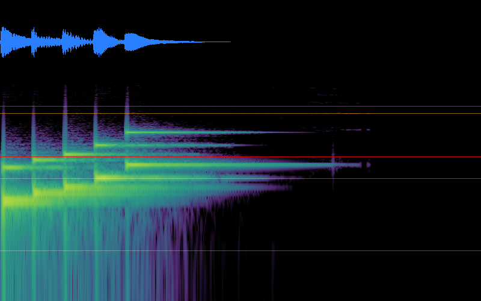

**pickup.wav**

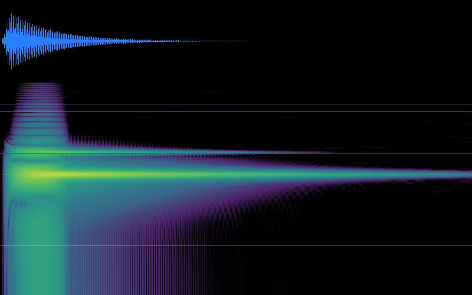

**pickup_hi.wav**

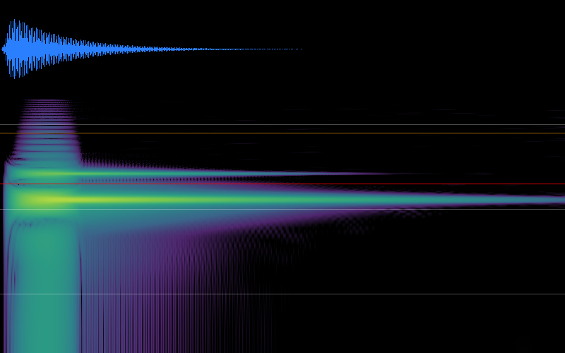

**pickup_lo.wav**

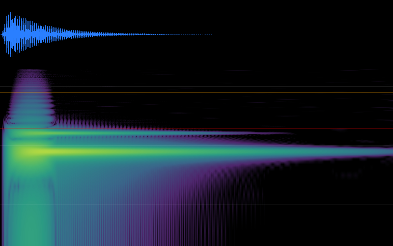

**run_end.wav**

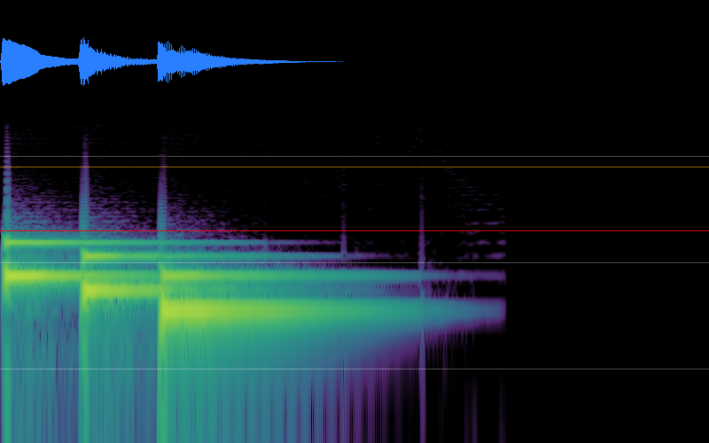

**run_start.wav**

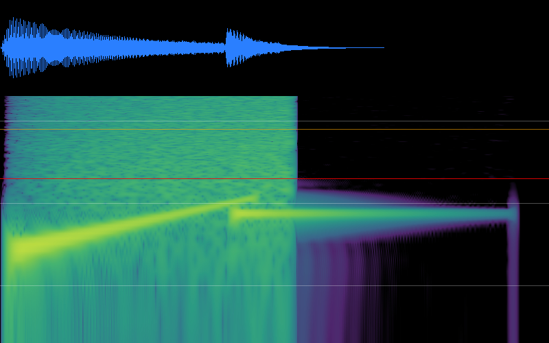

**shiny_bang.wav**


**shop_buy.wav**

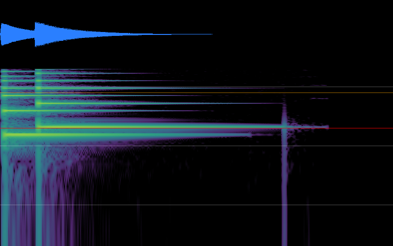

**shop_refresh.wav**

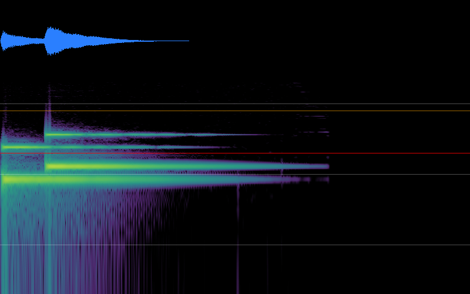

**ui_click.wav**

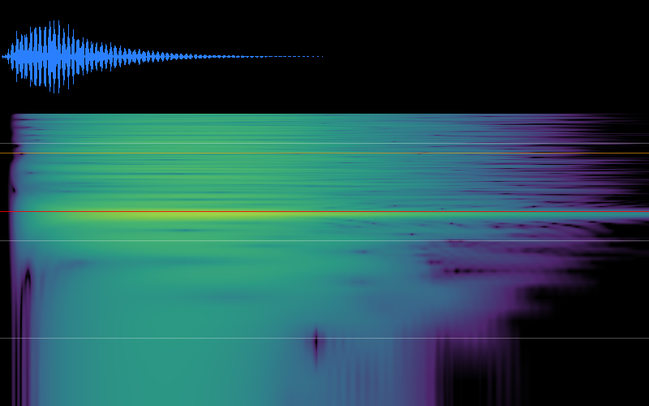

**weather_start.wav**

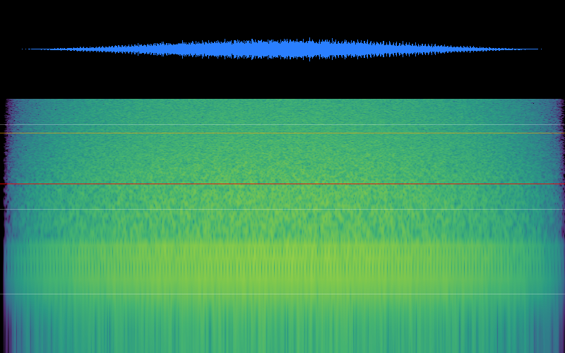
