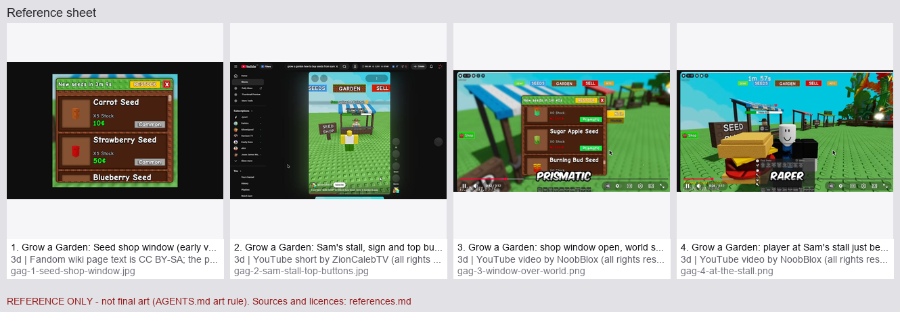

# References: shop-interactions

> **REFERENCE ONLY. These pictures are for looking at, not for use as final art, textures or icons (AGENTS.md art rule: final art is made in Blender or by the owner). Every picture keeps its own licence: do not republish it, keep the source link, and do not copy it into the game.**

4 pictures. Numbers match the labels on the sheet.

## 1. Grow a Garden: Seed shop window (early version)

- File: `gag-1-seed-shop-window.jpg` (3d)
- Source: https://growagarden.fandom.com/wiki/Seed_Shop
- Licence / author: Fandom wiki page text is CC BY-SA; the picture is a game screenshot (Roblox game, all rights reserved), look only
- Date read: 2026-10-18
- What to copy: One window over the world: green title bar with a calm restock line, one big red X to close, big cards with a picture, name, stock and one price. Frame taken from the wiki gallery image SeedshopUI.png at 800 px.
- Licence warning: this picture may not be free to reuse. Look at it only. Do not put it in the game.

## 2. Grow a Garden: Sam's stall, sign and top buttons

- File: `gag-2-sam-stall-top-buttons.jpg` (3d)
- Source: https://www.youtube.com/shorts/l1-uwsecud0
- Licence / author: YouTube short by ZionCalebTV (all rights reserved); paused frame, looked at only, look only
- Date read: 2026-10-18
- What to copy: The stall is easy to find: a wooden SEED SHOP sign, a striped roof, the shop keeper stands behind the counter, a name bar above him. Big word buttons at the top of the screen (SEEDS, GARDEN, SELL) jump you to the stalls. No prompt visible in this frame.
- Licence warning: this picture may not be free to reuse. Look at it only. Do not put it in the game.

## 3. Grow a Garden: shop window open, world still visible

- File: `gag-3-window-over-world.png` (3d)
- Source: https://www.youtube.com/watch?v=1BivUOJdM_w
- Licence / author: YouTube video by NoobBlox (all rights reserved); paused frame at about 0:42, look only
- Date read: 2026-10-18
- What to copy: The shop window sits on one side so the stall and the player stay visible. Top row of word buttons, one Shop button on the left edge. Rarity shown as a coloured word on each card.
- Licence warning: this picture may not be free to reuse. Look at it only. Do not put it in the game.

## 4. Grow a Garden: player at Sam's stall just before the window opens

- File: `gag-4-at-the-stall.png` (3d)
- Source: https://www.youtube.com/watch?v=1BivUOJdM_w
- Licence / author: YouTube video by NoobBlox (all rights reserved); paused frame at about 0:26, look only
- Date read: 2026-10-18
- What to copy: A small icon sits beside the keeper's name bar (the tap/press spot); the player stands right at the SEED SHOP sign. The window opened a second or two later. Exact trigger not proven by this frame.
- Licence warning: this picture may not be free to reuse. Look at it only. Do not put it in the game.

## Rules for using this set

- Reference only. Model from the notes above, in Blender or with the generator, and compare against these pictures.
- Never trace, import or re-upload a picture here as a texture, icon or sprite.
- Add the creature's line to docs/77-asset-registry.md when a model made from this set is added.
